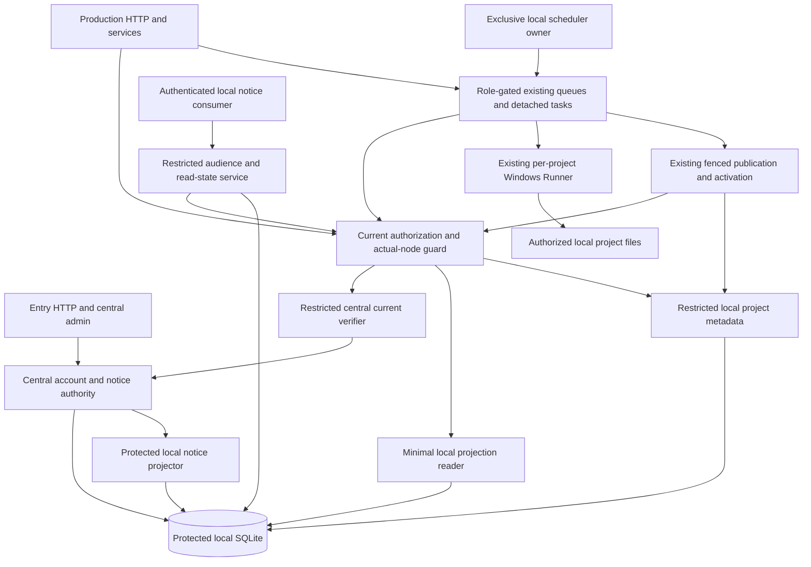
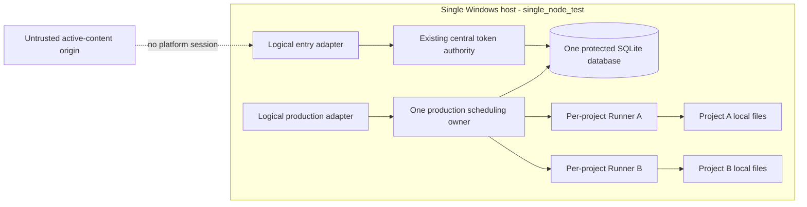

# Architecture Spine — S2-06

## Design Paradigm

**Layered control plane with capability-restricted adapters and durable fail-closed publication.** `Program.cs` is the trusted composition/HTTP boundary; central adapters own account/home/credential/publication facts; production services own local project operations through restricted contracts; existing SQLite and local disk own durable state; Windows Runners execute only within existing project isolation. This is a brownfield increment, not a new platform.

This is a finalized **authoring artifact**, not an Accepted ADR, implementation result or deployment approval. Inherited decisions below are already Accepted. Local AD-14..AD-26 are **new proposed design**, pending the adoption boundary below. Their IDs are local to this S2-06 spine. Parent AD-1..AD-13 retain their original ADR-0061 namespace.

Baseline: `25580d700da91d2702fd234a024a616d55419f90`. Source SPEC selection: `f085e26d53cb3fc8b2708532780a11295e12be2de5edc168a1e3b06f2ba9e2a4`. Neither hash proves runtime acceptance. The three upstream materials are complete Library text exports; their disclosed one-byte metadata size difference is not raw-download byte identity.

## Inherited Invariants

The accepted source is ADR-0061 plus its current addenda and the accepted 8-24 spine at `_bmad-output/planning-artifacts/architecture/architecture-phase-b-c-identity-isolation-workspace-recovery-2026-08-23/ARCHITECTURE-SPINE.md`. The later Accepted ADR-0061 addenda take precedence over obsolete parent detail.

| Inherited [ADOPTED] | Accepted source | Binds here |
| --- | --- | --- |
| Parent AD-1 | ADR-0061 / ADR-0034 | Server-owned account/project ownership; no caller identity authority. |
| Parent AD-2 | ADR-0061 | Verified context at HTTP, background and Runner boundaries. |
| Parent AD-3 | ADR-0061 | Current disable/revoke checks; inherited maximum cache ceiling remains, S2-06 sensitive checks are synchronous. |
| Parent AD-4 | ADR-0061 / ADR-0035 | Per-project Windows identity, ACL, Job Object, secret isolation and fencing. |
| Parent AD-5 | ADR-0061 | Logical workspace identity remains independent of node/path/Runner placement. |
| Parent AD-6 | ADR-0061, latest package-snapshot addendum | Immutable verified snapshot content, plus approved automatic snapshots for successful packages. |
| Parent AD-7 | ADR-0061 | Append-only restore attempt, staging/quarantine and verified publication. |
| Parent AD-8 | ADR-0061 | Durable DB/filesystem intent/outcome reconciliation. |
| Parent AD-9 | ADR-0061 / ADR-0036 | Current recovery sources and capabilities after restore. |
| Parent AD-10 | ADR-0061 | Existing single-node lease/fencing; no implicit scale-out. |
| Parent AD-11 | ADR-0061 | Additive migration, explicit legacy mapping, no orphan adoption or resurrection. |
| Parent AD-12 | ADR-0061 / ADR-0038 | Generated, redacted, current account-scoped evidence; no second authority. |
| Parent AD-13 | ADR-0061 | Real isolation evidence before stronger execution-tier claims. |
| SQLite/local disk and hashed token compatibility | ADR-0033 / ADR-0034 | Preserve existing stack/data/authentication; protected host owns metadata. |
| Shared execution and recovery | ADR-0035 / ADR-0036 / ADR-0037 / ADR-0039 | Existing commands, timeouts, cleanup, route authority and canonical runtime recovery. |
| Derived cache/domain/lifecycle separation | ADR-0044 | Shared sources, private projects, toolchain and runtime authority stay distinct. |

## Invariants & Rules

### AD-14 — Central authority and restricted node capabilities [NEW DESIGN]

- **Binds:** CAP-2, CAP-8, CAP-9, CAP-13; FR02/08/09/13
- **Prevents:** A project or production component becoming a second account, home, credential or publication authority.
- **Rule:** Use the existing layered control plane with capability-restricted adapters in the trusted composition root. Only the central adapter owns account state/home/credential writes and central notice publication. Production services receive separate sealed project, projection, authorization-check and read-state facades; they never receive PhaseAMetadataStore, a central-writer interface, a SQLite connection/factory, connection string, unrestricted options or IServiceProvider. The restricted facade object cannot be cast to a central writer. Existing combined-store implementation remains behind the trusted adapters and the one protected local database; the project Runner cannot read that database or protected configuration. Central services have no implicit ordinary-project dispatch capability. This is a trusted in-process dependency boundary for same-host tests, not OS isolation between .NET components or a remote service protocol.

### AD-15 — Stable physical placement without identity replacement [NEW DESIGN]

- **Binds:** CAP-1, CAP-2, CAP-3, CAP-8, CAP-11; FR01/02/03/08/11
- **Prevents:** Ports, endpoints, process identity or writable project settings rekeying ownership.
- **Rule:** Require a protected nonempty opaque ordinal node_id, explicit enabled_roles subset of entry/production, topology=single_service, endpoint purpose references and accept_new_accounts. Validate the node against persisted local binding before any production consumer exists. Account/project/workspace/run IDs and Windows Runner registration remain existing identities; node_id is the physical ownership/placement boundary only. instance_id is optional diagnostics. Endpoint/port/instance changes cannot change any binding. login_endpoint is central entry, workbench_endpoint is production, active_content_origin is untrusted content without a platform session. Reject missing/unknown roles, inconsistent identity, unsupported topology and active-content/session-origin collision; role is independent of PhaseServiceState. Never load these settings from a project, client node selector or Runner environment.

### AD-16 — One additive same-host ownership transaction [NEW DESIGN]

- **Binds:** CAP-2, CAP-3, CAP-9, CAP-10; FR02/03/09/10
- **Prevents:** Partial legacy adoption, destructive rebinding, orphan ownership or a second identity registry.
- **Rule:** Extend the existing SqliteMetadataSchema transaction with node_binding singleton, accounts.home_node_id, projects.node_id and account_node_projections. Persist central authority_revision on accounts and the corresponding projection revision. Additive columns may be nullable during installation; null never authorizes operation. In explicit single_node_test initialization, validate all existing account/project/workspace relations and protected registrations, bind legacy null values once to the configured node and materialize projections in that same transaction. Preserve non-null bindings and every existing identity/history/content hash. Any conflicting home/project/node, orphan owner or invalid registered workspace aborts the transaction and production startup without reset or overwrite. Restart verifies or idempotently completes only missing additive installation. New account binding and projection commit together centrally; new project owner is server-derived. Run/package/snapshot node follows the protected project row, without duplicating node fields across every artifact. Home reassignment and test-to-production migration are unsupported.

### AD-17 — Current central token verification with a minimal projection [NEW DESIGN]

- **Binds:** CAP-2, CAP-4, CAP-8, CAP-9; FR02/04/08/09
- **Prevents:** A stale enabled flag, copied credential or forged RequestContext granting local access.
- **Rule:** Retain existing host-admin and hashed user-token authentication. Trusted central authentication creates the existing RequestContext; project callers cannot construct authority by supplying its fields. Production projection is only account_id, home_node_id, enabled state and authority_revision; exclude username, password/token hashes, recovery secrets and credential material. Central enable/disable, expiry, rotation/revocation and initial home binding update authoritative account facts/revision and projection atomically. Every sensitive admission, dispatch, private read and publish/activation uses the trusted in-process central verifier for the current credential/account status and current home/revision; projection alone never authorizes. Reuse current credential representation through a trusted compatibility adapter and existing token verifier, without changing hashing or returning that representation to Runner/readback. Missing/stale projection must be refreshed from current central facts or deny. Administrative control still requires current admin scope and cannot waive actual-node locality. No second issuer, password store, cookie/session product or network exchange is introduced.

### AD-18 — One local scheduling owner for the physical node [NEW DESIGN]

- **Binds:** CAP-5, CAP-6, CAP-11; FR05/06/11
- **Prevents:** Independent processes each spending the same physical-node budget or bypassing cleanup through restart.
- **Rule:** The Windows host has one fixed protected ownership anchor at Environment.SpecialFolder.CommonApplicationData/JiMuYun/PhaseA/node-owner. It is outside every project/metadata generation, cannot be configured per instance and is writable only by the approved platform identity/administrators. Before production schema/binding work or constructing queues/Runner/recovery consumers, acquire node-owner/scheduler.lock once with FileMode.OpenOrCreate, FileAccess.ReadWrite and FileShare.None; no wait/retry takeover. This is the per-physical-node scheduling handle, shared by all Runners; its fixed path also rejects a second service using another database or node label on the same host. Diagnostic lock content may name node/instance but is not authority. Validate no reparse traversal and the protected anchor ACL before use. Keep the handle for the whole production lifetime. Under that ownership, persist scheduler_clean_shutdown=false in node_binding before work; graceful stop sets true only after all owned queues/tasks/children and publication callbacks have completed verified cleanup, then disposes the handle. Unknown cleanup retains the blocker/dirty state and denies reuse. A crash may release the OS handle involuntarily; the successor holds it with admission closed and must use existing registration/Job Object/run/lease/fencing reconciliation to prove cleanup before any ordinary dispatch. Unknown ownership blocks startup; no blind PID kill, lease expiry assumption or forced lock deletion. Entry-only opens no production scheduler. Independent multi-.NET production scheduling remains unsupported.

### AD-19 — The same actual-node check at every consumer boundary [NEW DESIGN]

- **Binds:** CAP-2, CAP-4, CAP-6, CAP-8, CAP-9; FR02/04/06/08/09
- **Prevents:** HTTP checks being bypassed by queues, direct services, tickets, cached readback or detached work.
- **Rule:** A trusted node-operation guard resolves verified RequestContext -> current central account/home -> current local projection -> protected project/account/node -> configured and persisted actual node. Require account authorization and equal home/projection/project/local node before any project file location is resolved. A new project requires the same chain without a preexisting project row and stamps its node from protected authority. A run/artifact/package/snapshot/ticket first resolves its existing protected project/workspace binding. Re-evaluate at admission, after queue wait at dispatch, before protected read/write and before publication/activation; an earlier permit is never a reusable bearer capability. Inside mutating project lock re-read current paths/generation and current node/role, retain credential reauthorization, lease/fencing and route prerequisites. Missing, null or conflicting ownership denies without remote fallback, silent reassignment or other-account existence disclosure. Administrative permission is explicit and never grants cross-node files.

### AD-20 — Explicit role composition and controlled shutdown [NEW DESIGN]

- **Binds:** CAP-5, CAP-6, CAP-8, CAP-11; FR05/06/08/11
- **Prevents:** Residual DI, default queues, startup recovery or Task.Run closures producing after production closes.
- **Rule:** Entry-only registers existing central authentication/home/admin and safe routing/health contracts, without ordinary workbench/project/Runner services, production queue instances, seeding, initialization recovery or preview preheat. Where compatibility requires a facade, it denies deterministically and cannot instantiate fallback consumers. Production registration requires validated node/binding, exclusive scheduler owner and cleanup barrier. All creation, initialization, unkeyed/keyed heavy queues, workflow/skill/chat, readback/tickets, detached preview/package restore, snapshot/restore/activation and recovery consumers obey the same role/guard, including direct and legacy overloads. Roles are startup immutable; controlled stop closes admission and all dispatch first, cancels waiting/in-flight owned work through existing mechanisms, and rechecks denial before publish. Authorized cancellation/verified cleanup and retained diagnostics remain accessible without granting ordinary production. Do not release slots/project locks/resource commitments as reusable on unknown cleanup. Entry-only restart never seeds/resumes ordinary work or infers success from completion artifacts. Preserve existing cancellation, execution and cleanup bounds and bounded run statuses; no new threshold or hot-role protocol.

### AD-21 — Extend existing storage publication and recovery authority [NEW DESIGN]

- **Binds:** CAP-2, CAP-4, CAP-6, CAP-10; FR02/04/06/10
- **Prevents:** A node increment rolling back identity, accepting stale generations or creating a second publication ledger.
- **Rule:** Retain existing SQLite durable intents/outcomes, Runner lock, monotonic lease/fencing, staging/quarantine, snapshot hashes/quota and Windows ACL verification. Add current node/role/home predicates at the existing protected operation and generation-activation transaction, without a second ledger or alternate activation path. Latest ADR-0061 addenda govern successful-package automatic immutable snapshots, stable registered export root, generation-pointer/history/succeeded-run atomic activation and generation-bound final revalidation; older parent explicit-only snapshot wording does not override them. Recovery owns only current verified local projects and respects existing cross-process publication coordination before classifying interruption. Normal file deletion and recovery only from valid covering snapshots remain. Snapshots restore project files only, never platform account/home/credential/node binding, Windows identities or DB history. Unknown cleanup cannot become a succeeded run or a reusable Runner.

### AD-22 — Physical capacity interface with honest unknown state [NEW DESIGN]

- **Binds:** CAP-7, CAP-11; FR07/11
- **Prevents:** Process count, online state or operator policy being mistaken for measured admission capacity.
- **Rule:** The node capacity read contract returns nodeId, online, acceptNewAccounts, measurementValid, capacityRef and readinessRef. Count each protected physical node once independent of Runner or diagnostic instance count. Online is local availability, acceptNewAccounts is policy, and neither implies measured readiness. Policy false denies new account admission on this node without reassigning, disabling or deleting existing accounts. Until S2-03A provides real current references, measurementValid=false and both references are null; emit no invented numeric capacity, measurement or automatic-placement claim. Invalid/missing references never authorize new placement; this does not disable already valid existing project use under current budgets. Keep existing per-service concurrency/admission variables and account limits; no queue/cache optimization raises them. Independent-process topology requires separately accepted design and real shared CPU/memory/process/disk/cache/queue budgets, locks/fencing, revocation/authentication and applicable Data Protection key evidence before enabling.

### AD-23 — Compatible self readback and safe entry routing [NEW DESIGN]

- **Binds:** CAP-1, CAP-3, CAP-5, CAP-7, CAP-9; FR01/03/05/07/09
- **Prevents:** A new node registry, selector or browser contract break masquerading as ownership readback.
- **Rule:** Extend existing authenticated GET /api/session additively with ownership containing homeNodeId, nodeId, scope=single_node_test, enabled logical roles and the capacity summary. Preserve authenticated/accountId/username/role and current auth transport. Resolve self only from central authenticated identity; inconsistent/uninitialized self ownership returns safe 409 conflict and no file access, while cross-account denial retains existing safe 403/404 convention. Admin diagnostics require explicit current admin scope and redact host paths/secrets. Entry-only can return central home/routing/session facts without constructing a workbench or queue; ordinary project endpoints/services deny. Protected endpoint references may support logical routing but never proxy another node's files or grant authorization. Preserve existing caller-visible envelopes/statuses, package busy/isolation errors and legacy cancel behavior; new errors use code/message/details/requestId with no-store. Retain existing browser session surface with a small ownership DTO/caller adapter; no React migration or new notification UI.

### AD-24 — Approved read-only shared versions and private copies [NEW DESIGN]

- **Binds:** CAP-8, CAP-12; FR08/12
- **Prevents:** Private project content becoming a shared source or cache hits broadening authority.
- **Rule:** An approved-source adapter accepts only existing protected approval identity plus concrete version/content hash or manifest reference; it never accepts arbitrary paths/URLs/project-selected source authority. Validate approval, byte integrity, operation and visibility on query/copy and on cache hits. Keep approved version bytes read-only outside projects, bounded host memory query cache derived, and private account/project/workspace-generation cache namespaces distinct. Keys include source version/hash, query implementation/version, parameters and visible scope. Missing scope/hash/approval or failed bounded authorized fallback yields denial/unavailable. A copied resource is independent editable project content with actual source/version and existing operation/run provenance; edits cannot claim original bytes and global updates cannot overwrite edits. AC08 implements only a small two-account same-host adapter/fixture; S2-01/04A/05 own real consumers and S2-02 provenance integration. No Phase Locator integration, new approval governance, shared private cache or new backend.

### AD-25 — Central notice facts with local audience and revision read state [NEW DESIGN]

- **Binds:** CAP-8, CAP-9, CAP-13; FR08/09/13
- **Prevents:** Project/port identity publishing notices, stale audience permission or mixed notice revisions.
- **Rule:** In the same protected local SQLite database, central admin/service alone writes notice facts with notice_id, revision, body, audience kind all/node/account and matching IDs, valid-from/until UTC, active/withdrawn state and change revision. A composition-selected in-process projector derives node-local rows carrying node/source notice/revision/change identity; production/project has no ingest/replace/publish capability. Fact and corresponding projection update commit in one transaction. Node read-state writes only the authenticated (account_id, notice_id, revision) key after checking current central enabled/home, local node, projected current revision, audience and UTC validity in that transaction. List/detail/count/read use the same predicate and latest protected facts; known expiry/observed withdrawal excludes a notice. All/node audiences evaluate eligible newly activated accounts during validity, not a frozen recipient list. Any body/audience/validity change creates a new monotonically increasing notice revision; withdrawal advances protected change revision. Never reuse a revision for different content. Revision changes have separate read state. Body is inert, contains no credentials and grants no execution/install/permission. AC09 is a small protected same-host publication/projection/read-state contract; no public ingest route, inbox/UI, periodic-refresh product or cross-host cursor protocol. Later stale refresh cannot extend expiry, change project permissions/results or alone block safe tasks.

### AD-26 — Test-only co-location and separate production initialization [NEW DESIGN]

- **Binds:** all; FR01..13 and AC01..09
- **Prevents:** Same-host contract/static Linux checks being sold as production, Windows or cross-host readiness.
- **Rule:** The delivered S2-06 increment targets one Windows production-owner service with multiple existing per-project Runners and co-located logical entry/production adapters only in explicit single_node_test. Production initialization/cutover is a separate authorized release operation with distinct role deployment and credentials, no test account/project transfer or secret reuse. Do not enable a separately hosted production role until an Accepted design and actual authenticated minimal-projection protocol exist; this increment does not provide that protocol. No network SQLite, second object storage, cross-node Worker, dynamic/manual account placement or migration is introduced. Active content remains closed until S2-05/S2-04B browser session/network isolation is proven. Formal account-product opening still requires Identity/password recovery/minimal soft-delete and HTTPS under their owners. Required Windows Runner/ACL/Job Object/handle/cleanup proofs and all nine scenario results must name the actual implementation HEAD and retained raw evidence before those runtime claims; document lint is not that proof.

## Dependency Direction

Arrows denote allowed use, not ownership transfer. Central writer/connection capabilities never flow to production consumers or project processes.

## Frozen Feature Interfaces

Names are logical C# contracts using existing async/cancellation conventions and existing DTOs where compatible. Their authority, dependency direction and result meaning are fixed; a method/namespace spelling change cannot widen them.

| Seam / owner | Input and output | Boundary |
| --- | --- | --- |
| `ICurrentAccountVerifier` / central | Existing server-created RequestContext -> current verified account/home/enabled/revision or denial | Existing token verification; no credential-store handle or secret in result. |
| Central account writer / central only | Existing authenticated admin/account operations -> persisted central state/home/revision and projection | Never registered as a production-facing capability; no home reassignment API. |
| `INodeIdentity` / trusted startup | Protected config plus node_binding -> immutable local node/role/scope | No client/project/instance selector. |
| `INodeAccountProjectionReader` / protected adapter | Verified account ID -> minimal local projection | No username/password/token hashes; stale data cannot authorize. |
| `INodeOperationGuard` / trusted guard | Current context, operation and existing project/run/artifact reference -> transient checked local context or denial | Resolve ownership before filesystem paths; never a serialized permit or cross-boundary authority. |
| `INodeProjectMetadata` / node adapter | Current checked context plus existing project/run/lock/activation commands | Existing account/project scoping and current node/role predicates; no arbitrary SQL, path, delegate or central writer escape. |
| `INodeSchedulingOwner` / composition and cleanup | Validated host/node -> held exclusive handle and cleanup barrier | Ordinary services cannot release/replace it. |
| Capacity reader / node | Protected physical node -> online/policy/measurement validity and nullable refs | S2-03A supplies measurement later, not an implementation prerequisite. |
| Approved source reader / existing source adapter | ApprovedSourceRef plus current authorized query/copy scope -> verified bytes/result or denial | AC08 fixture only now; later real consumers keep the same authority. |
| Central notice publisher / central admin only | Authorized current notice revision/facts -> fact/projection transaction | No production/project publish or ingest capability. |
| Local notice service / node | Current context plus list/detail/count/read operation -> audience-filtered result or revision read-state transaction | Same eligibility predicate on every surface; no account or notice revision spoof. |

Trusted storage adapters may share the existing store internally. They expose separate restricted objects and no service locator. Implementation must replace unrestricted store/options injection in the affected production consumer families, rather than merely adding interfaces while retaining a concrete-store escape. Narrow nonsecret execution options remain available where existing consumers need them.

## Persistence and Installation Seed

All logical records below use the existing protected **one local SQLite database**. No `ATTACH` transaction, new database or network mount is selected. Existing schema installation remains additive; native types/indices follow current SQLite conventions.

| Record | Minimum key and fields | Writer |
| --- | --- | --- |
| `node_binding` | Singleton key `1`; node_id, binding_version, initialization_scope, scheduler_clean_shutdown | Trusted startup/control owner only. |
| `accounts` additions | Nullable-at-install home_node_id; monotonic integer authority_revision | Central adapter; positive bound revision and immutable home after binding. |
| `projects` addition | Nullable-at-install node_id; existing account/workspace relations unchanged | Node adapter from verified central home/local node. |
| `account_node_projections` | account_id primary key; home_node_id, is_enabled, authority_revision | Central adapter in same account-state transaction. |
| `notice_facts` | notice_id primary key; current revision/body/audience/UTC validity/state/change revision | Central notice publisher; minimum local AC09 contract, not full product history. |
| `node_notice_projections` | Composite node_id + notice_id; source notice/revision/change reference and current visibility | Protected in-process projector in same publication transaction. |
| `notice_read_state` | Composite account_id + notice_id + revision; read state | Restricted local notice service after current eligibility check. |

Run/package/snapshot actual node resolves through existing protected project ownership. Do not mutate historical manifests, generation IDs, export roots, run status vocabularies or evidence hashes to add node fields.

Installation order binds independently built migration, auth and scheduler units:

1. Adopt the scoped ADR amendment below. Stop ordinary admission; validate explicit single_node_test configuration and inventory existing protected DB/workspace registrations. No live mutation is authorized by this artifact.
2. Acquire the fixed Windows host ownership handle before the production upgrade. Under it, execute the existing additive schema/required central-admin initialization plus S2-06 ownership/backfill/projection and dirty-start changes in one transaction. Validate all owners/registrations before commit; conflict aborts the whole binding increment.
3. Re-read persisted binding, instantiate separate central/node facades and complete the existing owned-process/lease/fencing cleanup recovery barrier with admission still closed. Failure preserves dirty/blocker evidence.
4. Compose only enabled responsibility consumers; open ordinary admission last. Entry-only may install compatible central schema but cannot backfill/repair/seed projects or construct a scheduler. On restart completed non-null bindings are invariant.

The node binding's shutdown bit does not replace existing project locks, run state or fencing. It prevents ordinary startup from assuming that OS handle release proves process cleanup. Normal shutdown retains the handle through all owned task/process cleanup. Crash successors must verify the existing owned-process boundary before any reuse; absence of proof blocks.

## Runtime Consumer Closure

Every row is required implementation work in existing consumers, not a claim the new guards already exist. Apply both account/actual-node and role checks; preserve existing route-specific authorization and errors.

| Current family | Required boundary |
| --- | --- |
| Program middleware/session/central admin; RequestContext; token resolution | Central authentication/current account/home; explicit allowed entry duties. |
| `/`, `/ui`, `/ui-v2`, `/projects/**`, project APIs/chat/workflow/skill actions | Entry-only denial of ordinary workbench/production; safe central session/routing remains. |
| ProjectCreationService, ProjectDraftImportService, creation limiter and Runner provision | Before admission, row creation, file seeding and native provision; retain disconnect cancellation and compensation. |
| ProjectInitializationService/RecoveryService; Workspaces/ProjectWorkspaceMaintenanceService; Program startup/preheat | Production-only registration and guarded dispatch; no seeding/recovery/success promotion on entry-only restart. |
| Creation queue; HeavyRunnerQueueService ExecuteAsync/ExecuteAuthorizedAsync/EnterAsync/TryEnter; unkeyed and prototype-creation/asset-generation/web-preview queues | Every overload must require role/current authority; remove implicit fallback queues, preserve serialization and verified cleanup. |
| Prototype workflow/iteration/goal/repair/feedback/quick-fix/UI/GDD/question-form; PrototypeCommandService; Chapter2BootstrapService; SkillActionService/chat | Direct service calls and after queue wait; retain eight-source recovery/shared LLM entrypoints. |
| ArtifactReadbackService, ProjectRouteStateArtifactService and inventories; direct run/artifact lookup | Resolve protected project/current node before private file or cached readback; no optional queue construction in entry facade. |
| ProjectPackageService, download/asset-preview tickets and redemption, ProjectWebPreviewService plus detached Program preview | Current ownership on issue and redemption/bytes; recheck dispatch/publication in detached task, not just HTTP closure. |
| Durable workspace operation Task.Run; WorkspaceStorageService/RestoreService; detached ProjectPackageRestoreService | Guard admission, staging, execution and existing protected activation; retain snapshot/quota/ACL/integrity and generation checks. |
| PhaseAMetadataStore.WorkspaceRecovery activation and current generation check | Extend existing transaction with current node/home/role predicates; no second publisher or stale snapshot authority. |
| HostedProcessRunner, WindowsProjectRunnerProvisioner, RunnerIsolationPolicy | Server-verified current local project launch; no central DB/config/credentials in Runner filesystem or inherited environment. |
| RunCancellationService, queue CancelRun and existing reconciliation | Authorized cancellation/cleanup remains while admission is closed; unknown cleanup never frees reusable capacity. |

## Operational Envelope

This increment does not create separate production-host deployment. Production role separation needs a separately authorized, authenticated projection/service protocol before it can be enabled; test co-location cannot satisfy that condition. Existing canonical runtime scripts, local-first recovery, host secret protection and HTTPS release rules remain. No provider/VM/container/cloud migration is selected.

## Consistency Conventions

| Concern | Convention |
| --- | --- |
| Identity | Existing opaque account/project/workspace/run IDs; node_id ordinal physical placement; instance/endpoint never rekey. |
| Schema | Existing snake_case SQLite, additive transaction install, non-null required before authorization; positive monotonic central revision. |
| DTOs | Existing camelCase and additive session ownership; no client home/node authority. |
| Time and notices | Persist UTC with existing round-trip format; per-notice revision is part of read-state identity. |
| State | Existing queued/running/terminal and legacy cancel compatibility; no new run status or timeout. |
| Errors/readback | Existing safe denial/busy/isolation mappings; new code/message/details/requestId; no-store; no raw paths, credentials or private existence leaks. |
| Resources | Physical node counted once; keep existing creation/queue/Runner/cleanup budgets and unknown-capacity denial. |
| Evidence | Current DB-bound evidence, source/generation binding, redaction and append-only failures; no second ledger/validator. |

## Stack

Brownfield pins were read from the current csproj. These are **preserved versions**, not claims that they are the latest available. Existing OS deployment constraints remain Windows; no OS edition/build upgrade is selected.

| Name | Version |
| --- | --- |
| C# / .NET / ASP.NET Core target | net8.0 / 8 |
| Microsoft.Data.Sqlite | 8.0.8 |
| SQLitePCLRaw.bundle_e_sqlite3 | 2.1.7 |

Current primary references confirm [SQLite async limitations](https://learn.microsoft.com/en-us/dotnet/standard/data/sqlite/async), [same-host WAL and attached-database atomicity limits](https://sqlite.org/wal.html), [Data Protection configuration responsibilities](https://learn.microsoft.com/en-us/aspnet/core/security/data-protection/configuration/overview?view=aspnetcore-8.0), and [FileShare.None semantics](https://learn.microsoft.com/en-us/dotnet/api/system.io.fileshare?view=net-8.0). They do not prove this platform's Windows behavior. No WAL-mode change or independent-service authentication support is inferred.

## Capability → Architecture Map

All IDs below preserve the original SPEC capabilities and S2-06 FR/AC mappings.

| Capability / requirement | Lives in | Governing decisions | Required scenario |
| --- | --- | --- | --- |
| CAP-1 / S2-06-FR01 | Protected config and session readback | AD-15, AD-23, AD-26 | AC01, AC02 |
| CAP-2 / S2-06-FR02 | Central home + node/project guard | AD-14, AD-16, AD-17, AD-19, AD-21 | AC02 |
| CAP-3 / S2-06-FR03 | Additive test binding and session | AD-15, AD-16, AD-23 | AC01, AC03 |
| CAP-4 / S2-06-FR04 | Direct/queued/file/publication boundaries | AD-17, AD-19, AD-20, AD-21 | AC02 |
| CAP-5 / S2-06-FR05 | Composition/entry vs production | AD-18, AD-20, AD-23, AD-26 | AC01, AC04 |
| CAP-6 / S2-06-FR06 | Every production consumer/shutdown/recovery | AD-18, AD-19, AD-20, AD-21 | AC04 |
| CAP-7 / S2-06-FR07 | Capacity reader/session DTO | AD-22, AD-23 | AC06 |
| CAP-8 / S2-06-FR08 | Protected config and restricted adapters | AD-14, AD-15, AD-17, AD-19, AD-20, AD-24, AD-25 | AC05 |
| CAP-9 / S2-06-FR09 | Central verifier/minimal projection | AD-14, AD-16, AD-17, AD-19, AD-23, AD-25 | AC05, AC06 |
| CAP-10 / S2-06-FR10 | Increment transaction/restart/cutover | AD-16, AD-21, AD-26 | AC03, AC06 |
| CAP-11 / S2-06-FR11 | Physical owner handle/budgets | AD-15, AD-18, AD-20, AD-22 | AC07 |
| CAP-12 / S2-06-FR12 | Approved source query/copy contract | AD-24 | AC08 |
| CAP-13 / S2-06-FR13 | Central fact/local projection/read-state contract | AD-14, AD-25 | AC09 |

## Verification and Adoption Boundary

Implementation must produce the SPEC's nine scenario results with both successful current project use and targeted refusal/recovery evidence. Use temporary SQLite/workspace fixtures only: AC01/02/03 cover stable IDs, endpoint spoof, additive rollback/restart/conflicting owners; AC04 exercises entry-only DI, all queue/direct/detached/recovery paths and shutdown cleanup; AC05 proves restricted central-write denial and actual Windows project/metadata isolation; AC06 shows single_node_test and invalid unmeasured references; AC07 proves real Windows independent-process handle collision, multiple Runners, crash/dirty recovery and unchanged physical count; AC08 proves two-account approved-source/private-cache/copy isolation; AC09 proves central-only publication, transaction interruption, current audience/expiry/revision/read filtering and forged control/port denial. Preserve existing API/browser regression and cancellation/lease/generation checks. Discoveries within listed consumer families must be closed before AC04 can pass; this bounded inventory is not a full endpoint audit.

**Required prior to protected implementation:** propose one narrow **ADR-0061 S2-06 addendum**, referencing this exact spine/revision and adopting new AD-14..AD-26 after owner review. Its concrete delta is central vs node capability ownership, additive home/node/projection transaction, synchronous current central verification, fixed host scheduler handle plus dirty recovery barrier, complete role closure and the AC08/AC09 contract seams. It extends ADR-0033/0034/0035/0038 and preserves parent AD-5 and current snapshot/generation addenda. Do not mark it Accepted by copying this artifact; existing ADR authority must adopt it first. No additional governance platform or giant replacement ADR is needed. A distinct future remote topology needs its own accepted/authenticated protocol design.

This architecture refines the SPEC-permitted signatures and installation order; it requires **no SPEC semantic change**. Typed adoption of the spine as a SPEC companion is a separate coordinator-owned operation. Do not hand-edit canonical SPEC during this stage.

Authoring evidence: `logs/s2-06-bmad-20261028/architecture-author/`; matched read-only knowledge sources: `logs/s2-06-bmad-20261028/knowledge-consumption/architecture/`. The author performed source reconciliation and native deterministic lint. Per explicit user override supplied before activation, **no BMAD rubric reviewer, configured reviewer lens, reviewer agent or editorial skill ran**; external A/B review follows separately. Wrapper tree verification proves unchanged native bytes only. No runtime AC, Windows process/ACL or cross-host scenario ran in this author stage.

## Deferred

- S2-03A owns real capacity measurements/readiness references and S2-03B cache/queue/game budgets and local/remote telemetry redaction. Current invalid-measurement and unchanged-budget rules already bind here.
- S2-01/04A/05 own real approved-source consumer/query/copy integration, S2-02 actual provenance connection. S2-06 AC08 contract/denials cannot be deferred with them.
- S2-04C owns the full persisted notification publish/revise/withdraw product, inbox/UI and periodic refresh. S3-03 owns authenticated service increments, cursor/baseline/retention/offline recovery. S2-06 AC09 local fact/projection/read-state contract remains required now.
- Independent multi-.NET scheduling, second-node admission, dynamic/manual account placement, remote authentication/projection and cross-node Workers remain unsupported until separately accepted designs and real shared-budget/auth/coordination evidence. No test-to-production transfer, distributed SQLite or second storage backend.
- Formal account password/Direct Mail recovery/minimal soft-delete and production HTTPS remain their owning packages' before-opening conditions; no new issuer, login method or secret product here.
- Browser active-content/session/network validation remains S2-05/S2-04B before opening those surfaces. Existing safe editing/download/desktop validation can proceed within proven bounds; no full React rebuild or Godot scope is added.
- Concrete SQL indices, C# file layout and method spelling remain implementation-owned within the frozen transactions and restricted seams. Provider procurement, new observability platform and whole-site design are outside this feature.
