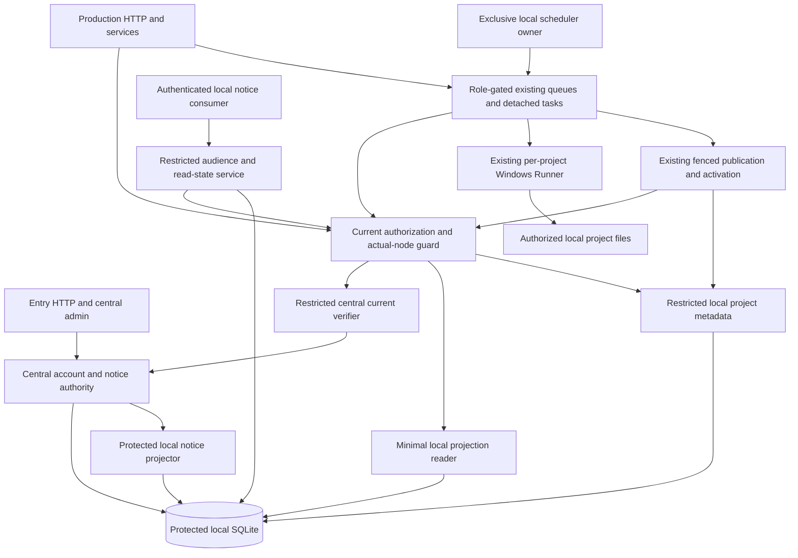
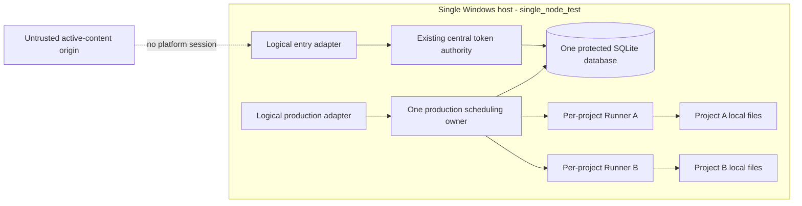

# S2-06 canonical VDD input projection

This is a content-preserving input-format projection, not a new product scope, BMAD artifact, plan-ready result or execution proof. The public compiler accepts FR/SM anchors rather than native CAP labels. Original files and their producer-owned roles remain authoritative and unchanged. CAP intent/success blocks below are copied without semantic edits. Complete normative companions and the adopted spine follow.

Scope: S2-06 only, all original 13 FR and 9 AC. Existing 8-24 capabilities are reuse and relevant regression, not new implementation. Other packages mentioned in sources remain excluded or downstream. No new permission, deployment, VDD completion or Windows result follows from this file. Authoring-stage process exclusions in preserved BMAD text apply to those completed authoring stages; the user separately authorized VDD, Quick Dev and Acceptance.

Canonical SPEC selection: cd7cc9c4c5e1dc66ce0f576f6d80cbcef71d3bb499a18ffbfff56ff58dad0dc3. Architecture authoring provenance retains its earlier f085 selection; subsequent owner-supported adoption changed only role/pointer metadata, not the original capabilities. The accepted repository ADR addendum records later scoped adoption of the preserved proposed design, not a rewrite of its authoring history. Baseline: 25580d700da91d2702fd234a024a616d55419f90.

## FR-1: S2-06-FR01 / CAP-1

Origin file: `_bmad-output/specs/spec-s2-06/SPEC.md`; native capability CAP-1.

- **CAP-1** — Stable physical identity (S2-06-FR01)
  - **intent:** Operators can keep physical node identity while access addresses and process diagnostics change.
  - **success:** Endpoint/port or instance change preserves node, account and project identities; login/workbench/active-content purposes are explicit.

## FR-2: S2-06-FR02 / CAP-2

Origin file: `_bmad-output/specs/spec-s2-06/SPEC.md`; native capability CAP-2.

- **CAP-2** — Server-owned account home (S2-06-FR02)
  - **intent:** The service keeps every account project, package, snapshot and execution on its one authoritative home.
  - **success:** Forged, missing or mismatched home cannot authorize access, execution or silent relocation.

## FR-3: S2-06-FR03 / CAP-3

Origin file: `_bmad-output/specs/spec-s2-06/SPEC.md`; native capability CAP-3.

- **CAP-3** — Persistent test binding (S2-06-FR03)
  - **intent:** Existing test accounts retain a server-bound single test node across additive upgrade and restart.
  - **success:** Binding and existing projects survive restart; readback declares single_node_test and never automatic placement.

## FR-4: S2-06-FR04 / CAP-4

Origin file: `_bmad-output/specs/spec-s2-06/SPEC.md`; native capability CAP-4.

- **CAP-4** — Actual-node enforcement (S2-06-FR04)
  - **intent:** Every local project read, write and execution respects physical ownership in addition to account authorization.
  - **success:** Home/project/actual-node mismatch is denied before file access or execution, without remote fallback.

## FR-5: S2-06-FR05 / CAP-5

Origin file: `_bmad-output/specs/spec-s2-06/SPEC.md`; native capability CAP-5.

- **CAP-5** — Logical role separation (S2-06-FR05)
  - **intent:** Entry and production duties are distinguishable when co-located for tests.
  - **success:** Entry-only keeps allowed login/home-routing/admin duties while ordinary workbench/projects/Runner production is unavailable.

## FR-6: S2-06-FR06 / CAP-6

Origin file: `_bmad-output/specs/spec-s2-06/SPEC.md`; native capability CAP-6.

- **CAP-6** — Role-aware dispatch (S2-06-FR06)
  - **intent:** Disabled production responsibility stops ordinary production through HTTP, services and background consumers.
  - **success:** Creation, all queue families, recovery and publication cannot bypass disabled role; cancellation and verified cleanup retain existing bounds.

## FR-7: S2-06-FR07 / CAP-7

Origin file: `_bmad-output/specs/spec-s2-06/SPEC.md`; native capability CAP-7.

- **CAP-7** — Honest capacity interface (S2-06-FR07)
  - **intent:** Consumers can distinguish node online state, account acceptance policy and measured readiness.
  - **success:** Unmeasured capacity is invalid with no fabricated reference; physical node is the counting key.

## FR-8: S2-06-FR08 / CAP-8

Origin file: `_bmad-output/specs/spec-s2-06/SPEC.md`; native capability CAP-8.

- **CAP-8** — Protected ownership configuration (S2-06-FR08)
  - **intent:** Project content and process diagnostics cannot change protected home, roles or endpoints.
  - **success:** Project node/port/config edits and central metadata attempts are denied without changing authority.

## FR-9: S2-06-FR09 / CAP-9

Origin file: `_bmad-output/specs/spec-s2-06/SPEC.md`; native capability CAP-9.

- **CAP-9** — Central versus local authority (S2-06-FR09)
  - **intent:** Central account/home/credential authority supplies only the identity projection needed for local production.
  - **success:** Same-host tests allow central writes, deny node/project central writes, exclude credential material from projection and retain current token authentication.

## FR-10: S2-06-FR10 / CAP-10

Origin file: `_bmad-output/specs/spec-s2-06/SPEC.md`; native capability CAP-10.

- **CAP-10** — Compatible test upgrade (S2-06-FR10)
  - **intent:** Existing test data stays usable through the node ownership increment.
  - **success:** Temporary-database upgrade/restart retains all identities; conflicts block without destructive reset or test-to-production transfer.

## FR-11: S2-06-FR11 / CAP-11

Origin file: `_bmad-output/specs/spec-s2-06/SPEC.md`; native capability CAP-11.

- **CAP-11** — Physical-node topology (S2-06-FR11)
  - **intent:** Multiple Runners share one physical ownership and capacity boundary.
  - **success:** Runner/instance identity cannot multiply homes/candidates/capacity; unsupported independent .NET topology is explicitly rejected.

## FR-12: S2-06-FR12 / CAP-12

Origin file: `_bmad-output/specs/spec-s2-06/SPEC.md`; native capability CAP-12.

- **CAP-12** — Approved shared content (S2-06-FR12)
  - **intent:** Accounts can consume one approved read-only version while private project data stays isolated.
  - **success:** Two-account contract validation proves shared version access and private project/snapshot/cache denial; edited copies never claim original bytes.

## FR-13: S2-06-FR13 / CAP-13

Origin file: `_bmad-output/specs/spec-s2-06/SPEC.md`; native capability CAP-13.

- **CAP-13** — Notification role contract (S2-06-FR13)
  - **intent:** Protected central publication authorizes node-local notification audience and read state.
  - **success:** Same-host contract validation denies forged project/port authority and filters list/detail/count/read by account/home, audience, validity and notice/revision.

## SM-SPEC-CONTEXT: Complete remaining canonical kernel context

The original frontmatter and Why are provenance/interpretation context; Constraints, Non-goals and Success signal retain their stated scope.

---
id: SPEC-s2-06
package_schema: canonical-spec-package.v1
companions:
  - path: _bmad-output/specs/spec-s2-06/identity-and-persistence.md
    role: normative_companion
  - path: _bmad-output/specs/spec-s2-06/consumer-and-role-boundaries.md
    role: normative_companion
  - path: _bmad-output/specs/spec-s2-06/shared-content-and-notifications.md
    role: normative_companion
  - path: _bmad-output/specs/spec-s2-06/verification-and-traceability.md
    role: normative_companion
  - path: _bmad-output/planning-artifacts/architecture/architecture-s2-06-20261028/ARCHITECTURE-SPINE.md
    role: adopted_companion
sources:
  - path: docs/requirements/s2-06/source/step2/S2-06/S2-06-requirements.md
    role: provenance
  - path: docs/requirements/s2-06/source/00-shared-scope-and-contracts.md
    role: provenance
  - path: docs/requirements/s2-06/source/01-dependencies-and-delivery.md
    role: provenance
  - path: _bmad-output/planning-artifacts/prds/prd-s2-06-20261028/prd.md
    role: provenance
  - path: _bmad-output/planning-artifacts/prds/prd-s2-06-20261028/addendum.md
    role: provenance
---

> **Canonical contract.** This SPEC, its four normative companions and its adopted Architecture Spine form the complete S2-06 planning contract. Sources are absorbed provenance. This is design authoring, not implementation or runtime acceptance.

> **Architecture handoff.** Read the adopted [Architecture Spine](../../planning-artifacts/architecture/architecture-s2-06-20261028/ARCHITECTURE-SPINE.md) alongside this contract; its local AD-14..AD-26 remain proposed pending owner ADR-0061 adoption before protected implementation, while inherited parent AD-1..AD-13 retain their Accepted authority.

# S2-06 Stable Node Identity and Test Role Boundaries

## Why

Accounts and projects need stable physical ownership before later packages add capacity and separated nodes. Current single-node identity and Runner foundations are reusable, but addresses and service processes must never define home. S2-06 makes server-owned home and entry/production responsibilities explicit while keeping existing test projects usable.

## Constraints
- Existing account/project/workspace/run identity, token authentication, .NET, local SQLite/disk, Runner isolation, locks/lease/fencing and snapshot/restore authority remain the foundation; browser/API compatibility is preserved.
- Protected configuration and metadata own node/home/roles; clients and writable projects cannot select them. Unknown or mismatched ownership fails closed without remote reads or reassignment.
- Central account/home/password authority and node-minimal projection must be separated in the same-host contract. Architecture freezes irreversible authority before interfaces; changed security/storage contracts require an Accepted ADR before implementation.
- One production service with multiple Runners is the minimum topology. Independent multi-.NET deployment remains unsupported until physical budgets, locks/fencing and same-role authentication/Data Protection evidence exist.
- Node capacity is counted once; online, policy and measurement validity are separate. S2-03A supplies real measurement; no numeric capacity or timeout is invented here.
- All four companions are normative: identity/persistence, real consumer/role boundaries, shared-content/notification contracts, and FR/AC verification. Their local contract tests do not prove Windows or cross-host operation.

## Non-goals

- Dynamic/user/admin node selection, account or test-project migration, second-node admission, cross-node Workers, distributed SQLite, remote user storage, second object backend or VM isolation product.
- Identity/Direct Mail implementation, second login method, account erasure, new credential authority, knowledge governance/sync, Phase Locator integration, Redis/KV/SignalR selection, full notification product/UI or cross-host notification protocol.
- Rebuilding completed 8-24 capabilities, user Git/GitHub, patch gateways, second ledgers/validators, full frontend or telemetry work, VDD/Quick Dev/Acceptance, deployment or runtime changes in this authoring stage.

## Success signal

All nine approved ACs have current evidence at their declared layer: stable identity and usable upgraded tests; denied forged ownership and disabled-role production; honest physical capacity; isolated approved-source and notification contracts. Completion additionally needs actual Windows Runner/isolation evidence where applicable; same-host contract success cannot certify cross-host behavior. This authoring run executes none of those runtime ACs.

## Assumptions

- Logical persistence/readback names in companions are minimum design choices within approved intent; architecture may refine signatures and installation order while preserving authority, data and compatibility. No product decision is inferred from the uninspected Newrouge repository.

## SM-IDENTITY-CONTRACT: Complete delivered normative_companion

Origin file: `_bmad-output/specs/spec-s2-06/identity-and-persistence.md`.

# Identity, Authority and Persistence Contract

Scope: S2-06-FR01/02/03/04/07/08/09/10/11. All interfaces below are required design contracts, not claims of existing code. Baseline: `25580d700da91d2702fd234a024a616d55419f90`.

## Authority first

| Owner | Authoritative operations | Permitted consumers and explicit denial |
| --- | --- | --- |
| Logical central service | Current account enabled state, credential verification/revocation, unique account home, administrator control | Existing token verifier and central account administration only. Neither production-local projection nor project identity can write account home/state/password/token hashes. |
| Physical production node | Own projects/files/packages/snapshots/runs and execution; local projection/read state | Restricted project/projection service contracts, current RequestContext and actual-node check. Cannot open another node's files or central host SQLite. |
| Existing knowledge control plane | Approved shared source/version facts | Read-only approved source adapters; cache/project copies cannot publish or approve a version. |
| User project | Editable game content and independent copied resources | Existing authorized project tools/Runner only. AGENTS/Skills/config/evidence copies are untrusted and cannot elevate service authority. |

Co-located tests retain one trusted composition root and existing local SQLite technology. Logical central and node stores may initially share the protected local metadata database; this is neither OS isolation between service components nor a cross-host data protocol. The central adapter alone receives account writer/credential-store capability. Production-facing components receive restricted local project/projection contracts; injecting the unrestricted central writer/connection into those components is prohibited. A node reader cannot bypass the adapter by using raw SQL. Architecture must make this dependency boundary executable and testable before implementation.

Current central authentication continues to resolve existing token hashes and produce the existing RequestContext; local production receives that verified context, never a copied credential authority. Dispatch/publication reauthorization invokes the trusted central adapter in process for this test arrangement. It cannot authorize from a stale local enabled flag alone. There is no second password store, token issuer or new network login/projection protocol. Later distinct-host exchanges require separately authenticated service contracts, not a network SQLite mount. Formal Identity/password recovery remains a separate before-opening condition.

## Protected configuration meaning

| Logical field | Meaning and validation |
| --- | --- |
| `node_id` | Explicit nonempty opaque, ordinal physical production identifier; initialized once and compared to persisted local binding. Never derive it from hostname, port, endpoint, username or Runner/process ID. Entry routing references this same one test production node. |
| `enabled_roles` | Explicit set of `entry` and/or `production`; logical responsibility, separate from existing `PhaseServiceState=development/test/production`. No implicit production fallback. Co-location of both is test-only. |
| `topology` | `single_service` baseline: one production service owns the node's queues/budgets; multiple registered Runners allowed. A second independently scheduling .NET service is unsupported unless the later proof gate is met. Two role adapters within that service do not multiply capacity. |
| `login_endpoint`, `workbench_endpoint`, `active_content_origin` | Protected mutable purpose references. Login is central entry, workbench is production, active content is untrusted and receives no platform session. Existing public URL HTTPS rule stays. No caller endpoint chooses a node. |
| `accept_new_accounts` | Explicit operator acceptance policy; false is refusal of new account admission, not reassignment or deletion of existing accounts. Does not override capacity validity or existing project admission. |
| `instance_id` | Optional diagnostic/coordination value only. Change/restart has no home or capacity effect. |

Before ordinary production is registered, reject missing/blank node identity, missing/unknown roles, physical binding conflict, unsupported topology, or an active-content session origin collision. Distinct origin references alone do not prove browser isolation: S2-05/S2-04B must verify all active entry points before opening them. Endpoint edits are validated independently and never update ownership. No live bind address or runtime secret is selected by this document.

Roles are startup configuration. Changing them requires controlled stop/restart; no hot role-switch API is specified. Entry-only startup must not construct ordinary production consumers. Formal production role separation/init is future authorized release work, not enabled by setting `PhaseServiceState`.

## Minimum persistence choice

Use the existing protected local SQLite metadata and additive installation pattern in `SqliteMetadataSchema.InitializeAsync`; no replacement database or duplicate identity registry.

| Logical record | Minimum persisted data | Owner / readback |
| --- | --- | --- |
| Local node binding singleton | Stable `node_id`, binding version, initialization scope | Trusted startup authority; admin diagnostic only. No capacity multiplier per service instance. |
| Existing accounts | Add nullable-at-install `home_node_id`; one value per existing account | Central account adapter alone writes once for this test increment; trusted home reader exposes only current self or explicit admin scope. |
| Existing projects | Add nullable-at-install `node_id` (actual physical owner) | Node metadata adapter sets it on creation from protected local identity and resolved account home. Never supplied by browser/game project. |
| Local account projection | `account_id`, `home_node_id`, enabled-state projection, authority revision | Central adapter materializes in protected platform metadata; node reader can read only needed local rows. No username/password/hash/token/recovery secret is copied. Missing/stale revision requires central refresh or denial. |
| Existing runs/packages/snapshots | Existing project/account/workspace and package/snapshot binding | Actual node resolves through protected project row; do not stamp node into every run/manifest/sidecar. Existing identity and content hashes stay stable. |

Projection revision is a monotonically changing local central-account fact used to detect stale state; it is not a new authentication system. Account/home/projection update commits together in the same local SQLite transaction. Disable/revoke still uses existing central credential behavior and execution-time checks. Home mutation/reassignment after binding is unsupported; reject rather than update it through this increment.

## Additive test binding and recovery

1. Validate explicit unique test node and protected existing database/workspace boundary. Install additive columns/records in the existing schema transaction. Preserve every account/project/workspace/run ID and all historical receipts.
2. Bind legacy null homes to that node only in the explicit single-node test migration. Verify each project references its real account and valid registered workspace; bind null project owner to the same node. Materialize minimal projections in the same transaction. Do not guess from files, URLs or browser fields.
3. A non-null different binding, orphan owner, invalid workspace registration or conflicting existing project owner aborts affected migration/production startup. No overwrite, destructive reset, silent reassignment or automatic cross-node repair. Preserve evidence for authorized repair.
4. Transaction interruption rolls back; restart safely repeats missing additive installation and verifies completed bindings. Existing valid non-null values are invariant. A role-only entry host cannot bootstrap ordinary projects to repair a mismatch.
5. Later reads/dispatch fail closed for unresolved null/missing homes or actual owner. New accounts bind only through central service to the one configured test node; capacity policy cannot invent future dynamic allocation. New project writes require the equality chain below.

No new production migration program exists. Future production starts separately, without moving test accounts/projects or reusing test secrets. No snapshots roll back account authority, protected node binding, Windows identity or database history.

## Actual-node contract

For an authorized operation, resolve `RequestContext.account_id -> central home -> protected local projection -> project.account_id/project.node_id -> protected configured/persisted local node`. Require matching owner and one node across that chain before resolving any filesystem location. Run/package/snapshot operations additionally follow their existing protected project/workspace/manifest binding. A token admin role does not imply cross-node file access.

Re-evaluate current role and this chain at admission, queued dispatch, protected file read/write and publication/activation boundaries. Preserve existing current-credential checks, workspace generation checks, project locks, fenced lease and route recovery. Cache hits, artifact JSON, RequestContext supplied by a project or an endpoint label cannot substitute for current authority. Missing/conflicting data denies the affected operation; there is no remote fallback.

## Readback and compatible failures

Extend existing authenticated `GET /api/session` additively with an `ownership` object: `homeNodeId`, `nodeId` (actual local production node reference), `scope: single_node_test`, enabled logical roles and the capacity summary below. Preserve existing authenticated/accountId/username/role fields and auth semantics. Resolve self from authenticated identity only. A home mismatch reports safe unavailability rather than another node's endpoint/details. Admin node diagnostics use an explicit admin-only service read contract; no new public registry or node selector.

Capacity summary has `nodeId`, `online`, `acceptNewAccounts`, `measurementValid`, nullable `capacityRef` and `readinessRef`. `online` means local service availability only. Policy true plus online true never means measured readiness. Until S2-03A supplies real current measurement, `measurementValid=false`, references are null and no numeric capacity is emitted. These fields do not replace existing per-service creation/concurrency budgets or enable placement; unproved readiness cannot admit a new placement. Invalid/unavailable references cannot be converted into synthetic success.

| Condition | New response mapping / compatibility rule |
| --- | --- |
| Unknown request node selector/config shape | `400 validation_failed`; user fields never affect ownership. Existing DTOs that ignore unknown fields may keep that behavior if no authority is gained. |
| Missing/revoked credential | Existing `401 authentication_required`. |
| Wrong account, node-home or prohibited role | Existing route's safe `403 forbidden` or `404 project_not_found` convention; do not reveal cross-account existence. |
| Self binding not initialized / inconsistent | `409 conflict` for an authorized self operation; admin diagnostic carries a safe bounded reason. No file access. |
| Local role/dependency unavailable | `503 service_unavailable` when appropriate to existing surface; static entry-only ordinary operations use the denial above. |
| Missing/conflicting startup config/topology | Fail startup/production registration with safe diagnostic; no fabricated HTTP success. |

New API errors use `{code,message,details?,requestId}`; details are redacted logical operation references. Existing caller-visible statuses/envelopes, including package-specific busy/isolation errors, are preserved. No unsupported run status is added: keep existing queued/running/terminal states and legacy `cancel` compatibility where already used. Browser/private/admin readbacks and errors remain `no-store`; never expose token material, host paths or secret configuration.

## SM-CONSUMER-CONTRACT: Complete delivered normative_companion

Origin file: `_bmad-output/specs/spec-s2-06/consumer-and-role-boundaries.md`.

# Consumer and Role Boundaries

Scope: S2-06-FR04/05/06/08/09/11. Bounded static inventory at the fixed HEAD; these are actual existing integration points and required changes, not evidence that guards already exist. Logical interface names may be refined by architecture without dropping consumers.

## Existing consumer families

| Actual source/symbol | Required node/role check and retained behavior |
| --- | --- |
| `PhaseA.Platform/Program.cs` composition/middleware and endpoint map; `Security/RequestContext.DemandAccount`; `Data/PhaseAMetadataStore.ResolveAccountByTokenHashAsync` | Authenticate current existing token centrally, then resolve home/role; never derive ownership from port. Registration/login/session/home/admin are entry responsibilities. Existing source has account checks, not the new physical-node contract. |
| `Program.cs` HTTP route /, HTTP route /ui, HTTP route /ui-v2, HTTP route /projects/{projectId}, ordinary HTTP route /api/projects/**, chat/workflow/skill-action entry families | Production workbench and project operations require production plus account/home/actual node; browser links cannot grant a default production duty. Central admin entry does not imply permission to execute ordinary project tasks. Keep existing route DTO/error compatibility. |
| `Projects/ProjectCreationService.CreateProjectAsync`, `ProjectDraftImportService`, `ProjectCreationConcurrencyLimiter` | Guard before admission, metadata creation, seeding and Runner provision; use protected home/node for new project. Keep existing host/account admission, HTTP disconnect cancellation and compensation of new resources. |
| `Projects/ProjectInitializationService` queued bootstrap / `ReconcileStaleInitializationsAsync`; `ProjectInitializationRecoveryService.ExecuteAsync`; `ProjectWorkspaceMaintenanceService.EnsureAllWorkspacesSeededAsync` | Production-only startup/background responsibilities. A role-disabled entry cannot seed/reinitialize a project, restart bootstrap or reconcile a run into success. Metadata-only central maintenance is separate from ordinary workspace mutation. |
| `Runs/ProjectCreationRunnerQueue`, `HeavyRunnerQueueService.ExecuteAsync`, `ExecuteAuthorizedAsync`, `EnterAsync`, `TryEnter` | Guard all admission/dispatch paths, including overloads lacking current-authority callbacks; an authorized overload alone does not cover direct paths. The unkeyed queue plus prototype-creation, asset-generation and web-preview keyed queues are all in scope. Preserve per-project serialization, cancellation and finally-release. |
| `Runs/PrototypeWorkflowService`, iteration/goal/repair/feedback/quick-fix/UI optimization, GDD/question-form, `PrototypeCommandService`, `Chapter2BootstrapService`, `Skills/SkillActionService`, chat route consumers | Guard actual local project before service work and again when queued work starts. Reuse route recovery/current evidence and shared LLM/Codex entrypoints. No second business validator or new route orchestration. |
| `Readback/ArtifactReadbackService` account-specific project/run/artifact methods; `ProjectRouteStateArtifactService`; asset/GDD/workflow inventories | Guard account/home/actual owner before any protected file read or cached readback. Metadata/admin readback stays explicit and redacted. Direct artifact/run IDs do not bypass project resolution. |
| `Readback/ProjectPackageService`, package download and asset-preview ticket services; `ProjectWebPreviewService.QueuePreviewAsync/GenerateQueuedPreviewAsync`; Program detached preview task | Resolve actual project before list/ticket/redemption/bytes. Production role required even for detached work; a ticket or Task.Run closure does not confer current authorization. Preserve expiry/revocation and stable historical export root. |
| `Program.cs HandleDurableWorkspaceOperationAsync` snapshot/restore/ACL entry; `Workspaces/WorkspaceStorageService`, `RestoreService`; `Readback/ProjectPackageRestoreService.AdmitAsync/ExecuteAsync`; `Data/PhaseAMetadataStore.WorkspaceRecovery.cs: ActivateWorkspaceGenerationAsync` | Check role/home/actual node before admission, staging/file access and protected activation; restore retains package/snapshot integrity, credential reauthorization, Runner lock, fencing, ACLs and atomic generation activation. Do not roll back central identity. |
| `Runs/HostedProcessRunner.RunAsync`, `WindowsProjectRunnerProvisioner`, `RunnerIsolationPolicy` and existing Windows registration/credential path | Launch only from server-verified local project context; node identity supplements existing Windows account, workspace registration and credentials. Do not expose central config/database to Runner/project. Existing token/OS identities are not replaced by node_id. |
| `Program.cs /api/runs/{runId}/cancel`, `RunCancellationService`, queue CancelRun and existing run reconciliation | Cancellation/cleanup remains reachable to authorized control while production stops. Role denial cannot strand a live process or release capacity without verified cleanup. |

This inventory is bounded to entry, scheduling, readback/storage and recovery families relevant to S2-06. It is not a full endpoint security audit; implementation must trace any newly discovered bypass within these families before claiming AC04. No runtime behavior has been proved by reading this table.

## Role operation matrix

| Operation | Entry-only | Production responsibility |
| --- | --- | --- |
| Existing central login/token resolution, account state/home administration and routing | Allowed under existing auth/admin scope | Consume verified context/minimal projection, no account/home/password writer capability |
| Ordinary project/workbench/Runner create/read/write/run/package/restore | Denied locally; logical home routing only | Allowed only on matching local home with existing authorization |
| Central protected notification publication | Approved central admin/service only | No publication authority |
| Node notification audience/read-state contract | No implicit ordinary project task | Approved protected local service; account/home filtered |
| Shutdown cancellation/cleanup and retained diagnostics | Authorized control permitted | Required for owned work even when admission is closed |

Production service registration is explicit: entry-only must not register active production hosted recovery, background schedulers or ordinary queue consumers. If a compatibility facade is required to construct central admin pages, it must return deterministic denial and cannot initialize a default queue/Runner. Direct service calls are guarded as well as HTTP; DI presence is never authority.

## Disabled-role transition and restart

Roles change only through controlled stop/restart, avoiding a new hot-configuration protocol. First close ordinary admission and stop polling/dispatch from all queue families. Cancel waiting work through existing queue/cancellation mechanisms; record its existing terminal cancellation/block reason with correlation. For in-flight work, use existing cancellation and child/process cleanup under existing bounds. Recheck before protected publish/activate; a stale admission cannot authorize publication after production closes. Already-performed game-file edits are not promised undone.

Do not release a project lock, queue slot or resource commitment as reusable while cleanup is unknown. Retain blocker/evidence and apply existing reconciliation; detectable cleanup failure blocks Runner reuse. Entry-only restart does not resume or produce abandoned ordinary work. Only a production-authorized recovery owner may apply existing reconciliation rules, with current home, generation and lease/fencing. Never turn a queued/completion artifact into succeeded merely because the process restarted.

No new timeout, capacity limit, status enum or retry budget is introduced. Existing bounded execution/cancellation/recovery policy remains with its actual consumer. The same principle applies to the special detached preview task and package restore task: inspect current role/authority at dispatch and publication, not only in their HTTP admission closure.

## Topology and authority gate

`node_id` counts one physical production owner regardless of Runner count or optional instance diagnostics. One active scheduling service with several Runners is supported minimum; existing per-service creation/concurrency variables remain per-service, not distributed promises. Two logical role adapters can be co-located inside that service for AC01. Before queues/hosted workers register, the scheduler must acquire one exclusive host-owned ownership handle keyed to the protected physical node binding; a second scheduling service fails startup, even if both declare single_service. Release only when the owning process and its work have stopped. This is a local process guard, not a distributed lock or permission to support multi-service scheduling. The existing RestoreService cross-process FileShare.None pattern is a local mechanism reference; architecture must freeze the actual protected handle location and lifetime without widening restore or resource policy.

Independent .NET production schedulers are rejected as unsupported until actual shared physical CPU/memory/process/disk commitments, queues and cache budgets, locks/leases/fencing, revocation state and same-role authentication/Data Protection keys are demonstrated. A process cache, AddDistributedMemoryCache or KV's existence is insufficient. Do not choose Redis/Upstash or raise parallel limits to satisfy AC07. Architecture must explicitly freeze any future topology before enabling it.

## SM-SHARED-NOTIFICATION-CONTRACT: Complete delivered normative_companion

Origin file: `_bmad-output/specs/spec-s2-06/shared-content-and-notifications.md`.

# Shared Content and Notification Contracts

Scope: S2-06-FR12/13 and applicable shared revision-6 constraints. These minimum same-host contracts are required now; full knowledge consumer/product and notification UI/transport remain with their owners.

## Approved shared content boundary (AC08)

Existing approval/maintenance facts select a protected read-only version directory. A logical `ApprovedSourceRef` includes approved source identity, concrete version and content hash/manifest reference. It is an allowlisted service reference, never a project-supplied host path or arbitrary URL. Query/copy validates current approval, requested operation, source bytes and account/project visibility before returning content. Missing source/approval/scope, hash mismatch or failed bounded fallback returns unavailable/denial, never a success based on stale cache.

| Data | Authority and permitted use |
| --- | --- |
| Approved knowledge/demo bytes | Existing protected version authority; multiple accounts may read the same approved version. Shared does not mean writable or cross-node user storage. |
| Node shared query cache | Derived, host-owned bounded memory in the one-service baseline; key includes source version/hash, implementation/query version, parameters and visible scope. Authorization is rechecked on a hit. Failure permits only bounded authorized fallback. |
| Private project index/query cache | Account/project/workspace-generation scoped, separate from shared namespaces; no cross-account lookup or shared current/LKG pointer. |
| Copied project resource | Independent editable project content under existing project tools; record actual source/version and operation/run connection when consumed. Edits cease to represent original bytes; global version updates never overwrite user edits automatically. |
| Account home/password, resource commitment, route result, recovery/acceptance | Never cache authority; use existing protected owners. No source update invalidates unrelated unconsuming projects' acceptance. |

AC08 requires a small adapter/contract fixture using one approved version and two accounts: both can consume the same read-only source; neither can designate a private project as an approved source or read the other's project/snapshot/private cache. Demonstrate copy isolation and hash/provenance truth after edits. This is contract validation, not a full new Phase Locator integration. Existing repository Locator is not a project capability and a child invoking a CLI cannot create trusted context.

S2-01/S2-04A/S2-05 own real consumer/query/copy integration; S2-02 owns actual operation provenance; S2-03A/B own measured cache/queue budgets. File-byte caching and small parsed-object caching differ; demo files are not bulk KV contents. Multi-process shared query/KV is optional only after measured need and topology proof. Cache/queue/game budgets remain distinct; caching cannot raise safe concurrency or replace session revocation/locks.

## Notification authority (AC09)

Use protected platform SQLite metadata for the local contract, separate from projects. The following are logical records to make authority/denials testable, not a full S2-04C database/API/UI design or S3-03 protocol.

| Logical record | Writer and content | Reader |
| --- | --- | --- |
| Publication fact | Existing central admin/service authorizes notice identity/revision, body, audience kind (`all`, `node`, `account`) and matching audience IDs, valid-from/until UTC, active/withdrawn state and protected change revision | Approved in-process projection adapter only; production/project cannot author or replace facts |
| Node audience projection | Central-authorized adapter derives matching node-local facts from publication; stores source notice/revision/change reference and current visible status | Restricted node reader; projection is derived, never authority to publish or change permissions |
| Local read state | Node read-state service writes `(account_id, notice_id, revision, read)` for the authenticated matching home/account | Same account filtered list/detail/count and mark-read; no cross-account history/audit product |

The publisher uses existing administrator authority; browser port, node endpoint, ordinary account/project RequestContext or a supplied control-identity string grants no publish/projection-ingest capability. The approved in-process adapter is registered by protected composition and cannot be chosen by project input. There is no new public ingest route, arbitrary endpoint proxy or remote credential protocol in S2-06.

An AC09 contract test must publish through the central capability, derive a node audience projection, query as eligible/ineligible accounts and mark the current revision read. Local publication/projection update is atomic within its protected local transaction; interruption must not expose a mixed revision. A read-state key cannot mark another revision or account read; a new revision has its own read state. Reject project authority attempting central writes or projection replacement even if it supplies a legitimate node ID/port. No credential values enter records/readback.

All list, detail, count and read operations enforce current enabled account, home, local node, audience and validity together. `all`/node audiences include newly activated eligible accounts during the validity interval, without precomputing a permanently frozen recipient list. Known expiry is effective even while refresh is pending. Withdrawn notices are excluded after the protected local update is observed. Notification body is inert content: no command, Agent launch, installation or authorization. Read state does not become user behavior audit or project evidence.

For S2-06 same-host validation, read current protected facts directly/derive synchronously; no remote cursor is needed. Later S2-04C owns full persisted publish/revise/withdraw, inbox/UI and periodic refresh. Later S3-03 owns authenticated service increments, durable change records, atomic projection/cursor, retries/deduplication, offline continuation, epoch/baseline/watermark/retention/UTC decisions and real cross-host evidence. Do not claim these work because local contract tests pass.

Delayed or unavailable future refresh is displayed honestly as stale/pending; known expiration never extends, permissions and project/run results never change, and backlog alone does not block otherwise safe tasks/registration. Do not promise instant offline withdrawal or unlimited history. SignalR/Redis backplane/PubSub could only optimize online refresh, not publication truth or offline recovery. Make/Zapier cannot own node control, permission or dispatch.

## Applicable platform guardrails

Platform shared sources, central facts, node-local projections, private projects and toolchain lifecycle each keep separate authority/current/cache. All file/queue/background paths retain current server authorization, low-privilege Runner isolation, bounded resources and approved networking. A fixed trusted service channel does not grant network access to a game process or project Agent. Arbitrary user Skill/MCP/plugin/software installs, tool markets and automatic approval are excluded.

Existing normal file deletion, usable covering-snapshot recovery, DB-bound validation/evidence and route recovery remain; no recycle bin, per-overwrite backup or guaranteed recovery is added. Execution-boundary reauthorization (S2-05/S2-04A), ordinary run redaction/SLS/Sentry limits (S2-03B) and active-content browser/session/network isolation (S2-05/S2-04B) remain actual release conditions for those consumers. Identity/Direct Mail and minimal soft-delete remain before formal account-product opening, even on one node; S2-06 uses existing test tokens without claiming those products complete.

## SM-VERIFICATION-CONTRACT: Complete delivered normative_companion

Origin file: `_bmad-output/specs/spec-s2-06/verification-and-traceability.md`.

# Verification, Traceability and Evidence Limits

This is a normative verification contract, not a test execution report. Original S2-06 revision 5, shared scope/dependencies revision 6, frozen PRD and addendum are fully absorbed. All thirteen original FR and nine AC retain their IDs and scope in one package.

## FR preservation matrix

| Requirement | Capability | Normative contract | Original AC mapping |
| --- | --- | --- | --- |
| S2-06-FR01 stable node/roles and endpoint purposes | CAP-1 | identity-and-persistence: protected config and readback | AC01, AC02 |
| S2-06-FR02 unique server home/locality/no request override | CAP-2 | identity-and-persistence: authority and equality chain | AC02 |
| S2-06-FR03 persistent unique test binding | CAP-3 | identity-and-persistence: additive migration/recovery | AC01, AC03 |
| S2-06-FR04 actual-node read/write/run refusal | CAP-4 | consumer-and-role-boundaries: every consumer family | AC02 |
| S2-06-FR05 entry/production duties | CAP-5 | consumer-and-role-boundaries: role operation matrix | AC01, AC04 |
| S2-06-FR06 DI/queue/recovery cannot continue production | CAP-6 | consumer-and-role-boundaries: transition/dispatch | AC04 |
| S2-06-FR07 online/acceptance/readiness validity | CAP-7 | identity-and-persistence: capacity interface | AC06 |
| S2-06-FR08 protected config outside projects | CAP-8 | identity-and-persistence: central vs local capability | AC05 |
| S2-06-FR09 central home/password vs minimal projection | CAP-9 | identity-and-persistence: restricted stores/current central auth | AC05, AC06 |
| S2-06-FR10 additive test usability/future cutover separation | CAP-10 | identity-and-persistence: binding/restart/cutover | AC03, AC06 |
| S2-06-FR11 physical count/instance diagnostics/topology rejection | CAP-11 | consumer-and-role-boundaries: topology gate | AC07 |
| S2-06-FR12 approved shared version vs private user data/cache | CAP-12 | shared-content-and-notifications: source/cache/copy boundary | AC08 |
| S2-06-FR13 central publication vs local audience/read state | CAP-13 | shared-content-and-notifications: notification contract | AC09 |

## Nine required acceptance scenarios

| Scenario | Targeted evidence after implementation | Required failure/recovery observations |
| --- | --- | --- |
| S2-06-AC01 | Temporary existing accounts/projects, one physical node, two co-located logical roles; authenticate, read session/home, use current project | Roles distinct; same IDs and test home before/after normal use. Existing project/Runner behavior remains usable. Evidence labels same-host test only. |
| S2-06-AC02 | Change endpoint/port; submit node/home fields and wrong-home project/run/package/snapshot requests | Same node/account/project IDs; deny before file bytes/process execution; no remote fallback or other-account existence leak. Include ticket/direct artifact/readback paths and server-level invocation. |
| S2-06-AC03 | Temporary pre-upgrade SQLite/workspace with real existing IDs; additive install, interruption/rollback, restart and readback | Null legacy binds once; completed binding unchanged; conflict/orphan registration aborts without overwrite/reset. Projects/runs/history/usable snapshots retained. |
| S2-06-AC04 | Entry-only composition plus all actual queue/service/recovery families; simulate shutdown with waiting and in-flight owned work then entry-only restart | No seeding/create/execute/publish via DI/default/direct/background path; existing cancellation/cleanup bounds honored, no unknown cleanup reuse, no completion-artifact success. Allowed entry/admin and control cleanup work. |
| S2-06-AC05 | Project edits to node/port/config and attempts against central metadata/credential writer; restricted production projection calls | Denial without central change; no password/token hashes in projection, file readback or logs; central authenticated writer still works and current disable/revoke affects dispatch. True Windows Runner/ACL evidence required for OS claims. |
| S2-06-AC06 | Read same-host contract with no real registration/health/remote transport and no S2-03A measurement | scope single_node_test; online/policy separate from invalid measurement/null refs; missing required ownership fails closed. No automatic placement, measured capacity, production split or multi-host claim. |
| S2-06-AC07 | Several actual Runners under one service; alter instance diagnostics; attempt independent scheduler topology | Home/project/node/candidate count unchanged; capacity counted once. Independent services rejected unless real shared budget/lock/fencing/auth/Data Protection proof exists; no fake shared cache proof. |
| S2-06-AC08 | Small approved-source contract fixture with two accounts, shared version query/copy and private-source attack | Shared read-only bytes/version valid; copy edits isolated/provenance honest; project/snapshot/private cache inaccessible to other account. Hash/missing scope/cache hit denial and bounded fallback failure covered. No Phase Locator integration claim. |
| S2-06-AC09 | Small protected same-host publication/projection/read-state contract with eligible/ineligible/newly activated accounts, notice revisions/expiry and forged project/port identity | Central publisher only; node service filters all query/count/read surfaces; read keyed to account/notice/revision; interrupted local update atomic; inert body, no secret leak. Local evidence does not certify cross-host transport/offline recovery or full notification product. |

Use the smallest targeted existing service/API/store/browser tests that prove each changed consumer. Temporary SQLite and workspace fixtures only; no live metadata or Hosted projects. Include compatible existing callers and error/no-store behavior. Test successful operations as well as actual mismatch, unauthorized, missing/invalid reference, cancellation and restart cases; do not build a universal gate or blanket test suite for this document.

## Baseline and source interpretation

Bounded current-code observations are recorded in `logs/s2-06-bmad-20261028/spec-author/bounded-source-inventory.json`. AccountSnapshot/ProjectSnapshot/RunSnapshot and RequestContext contain reusable identity but no explicit node/home contract. Program registers production queues/recovery without the proposed role boundary. SQLite already installs additive fields. These observations motivate the minimum changes; they are not claims of implementation or exhaustive endpoint coverage.

Source exports are Library text exports, each one byte shorter than original metadata. Preserve their actual bytes and five provenance roles; do not claim downloaded-original byte identity. The originals' historical code references are rationale only; this design inspects current fixed HEAD `25580d700da91d2702fd234a024a616d55419f90`. Newrouge has not been inspected. External PRD review history is a handoff fact, not source authority for product requirements.

Knowledge activation executed the actual configured callback, with matched request/result and raw pinned-main source bytes saved under evidence directory logs/s2-06-bmad-20261028/knowledge-consumption/spec. Adopt ADR-0035/0061 for existing Runner/storage/restore and cancellation, Phase ADR index for accepted boundaries/change policy, ADR-0044 for derived-cache/lifecycle authority, and hosted-workspace/route-recovery sources for file/readback/recovery. Godot engine/UI standards were read but add no new Godot requirements to this metadata/role package; existing runtime route gates remain inherited.

## Applicable shared claims and exclusions

| Shared source claim | Disposition |
| --- | --- |
| Current .NET/SQLite/node-local storage/identity/Runner and existing snapshots/restoration | Preserved in kernel and identity/consumer companions; no rebuild or second authority. |
| Single physical count, shared budgets vs process cache, minimal approval/copy provenance, protected local notices | Normative contracts above; owner boundaries S2-03A/B, S2-01/02/04A/C/05 and S3-03 stay explicit. |
| Three authority layers, no user install/MCP/tool/network expansion, all writes/backgrounds under same boundary | Preserved in authority and guardrail contracts. No new policy platform. |
| Current credential recheck, output redaction, result binding, active-origin isolation, normal delete and snapshot limits | Existing owner requirements remain release conditions; S2-06 actual-node checks supplement them, never waive them or claim their runtime proof. |
| Formal account password/recovery/minimal soft-delete, HTTPS before opening | Future separate opening conditions; no current Identity/Direct Mail/deployment implementation. |
| All other packages' visual/UI/telemetry/market/governance features and 17-package ordering | Context/non-goal only; no normative implementation expansion. Local UI modularity applies if later consumers touch browser calls; retain current session surface with additive DTO adapter, no new UI or React claim. |
| External framework/product reference links | Upstream rationale; no new dependency/version choice, web research or framework upgrade required by this minimum design. |

## Architecture and delivery handoff

Architecture must freeze central vs node write authority first, then cross-cutting identity/topology/security, runtime dispatch and feature interfaces. This SPEC selects a minimum logical SQLite/projection/readback contract now; architecture must resolve incompatible low-level details before implementation rather than silently defer every storage choice. A change to auth, ownership, persistence or dispatch security requires a new/amended Accepted ADR; this run creates or marks none Accepted. Existing ADR-0035/0036/0038/0061 inheritance remains.

S2-06 may be the first step2 package: it defines capacity interfaces, S2-03A later supplies actual measurement. No implementation cycle or automatic registration is implied. Formal production initialization is separate and cannot reuse test secrets or transfer test accounts/projects. Do not silently broaden same-host source/test evidence into deployment authority.

There is no unresolved product question blocking architecture. The recorded assumption permits signature/order refinement only while preserving these minimum contracts. A real authority contradiction or incompatible API change must be surfaced before implementation; it cannot weaken an FR/AC.

## Honest completion boundary

This run authors SPEC and four normative companions and performs the native author's coherence/preservation sweep. No BMAD reviewer, independent self-review, story breakdown, VDD, Quick Dev, Acceptance, schema/auth/runtime code change or deployment runs. Native publication/typed selection proves package transport, not scenario runtime success.

No Windows Runner, ACL, real process coordination, Godot/runtime or cross-host scenario was executed here. Linux static reads and contract authoring cannot substitute for Windows isolation or later authenticated second-host tests. Future implementation evidence must name exact HEAD/diff, actual consumer paths, raw results and unresolved limits; failures stay append-only. Independent external A/B SPEC review is a later coordinator-owned stage.

## SM-ARCHITECTURE-CONTRACT: Complete delivered adopted_companion

Origin file: `_bmad-output/planning-artifacts/architecture/architecture-s2-06-20261028/ARCHITECTURE-SPINE.md`.

---
name: S2-06 stable physical node identity and test role boundaries
type: architecture-spine
purpose: build-substrate
altitude: feature
paradigm: layered control plane with capability-restricted adapters and durable fail-closed publication
scope: S2-06 single-node test ownership and entry/production responsibility increment
status: final
created: 2026-10-28
updated: 2026-10-28
binds: [CAP-1, CAP-2, CAP-3, CAP-4, CAP-5, CAP-6, CAP-7, CAP-8, CAP-9, CAP-10, CAP-11, CAP-12, CAP-13]
sources:
  - _bmad-output/specs/spec-s2-06/SPEC.md
  - _bmad-output/specs/spec-s2-06/identity-and-persistence.md
  - _bmad-output/specs/spec-s2-06/consumer-and-role-boundaries.md
  - _bmad-output/specs/spec-s2-06/shared-content-and-notifications.md
  - _bmad-output/specs/spec-s2-06/verification-and-traceability.md
  - docs/requirements/s2-06/source/step2/S2-06/S2-06-requirements.md
  - docs/requirements/s2-06/source/00-shared-scope-and-contracts.md
  - docs/requirements/s2-06/source/01-dependencies-and-delivery.md
companions: []
---

# Architecture Spine — S2-06

## Design Paradigm

**Layered control plane with capability-restricted adapters and durable fail-closed publication.** `Program.cs` is the trusted composition/HTTP boundary; central adapters own account/home/credential/publication facts; production services own local project operations through restricted contracts; existing SQLite and local disk own durable state; Windows Runners execute only within existing project isolation. This is a brownfield increment, not a new platform.

This is a finalized **authoring artifact**, not an Accepted ADR, implementation result or deployment approval. Inherited decisions below are already Accepted. Local AD-14..AD-26 are **new proposed design**, pending the adoption boundary below. Their IDs are local to this S2-06 spine. Parent AD-1..AD-13 retain their original ADR-0061 namespace.

Baseline: `25580d700da91d2702fd234a024a616d55419f90`. Source SPEC selection: `f085e26d53cb3fc8b2708532780a11295e12be2de5edc168a1e3b06f2ba9e2a4`. Neither hash proves runtime acceptance. The three upstream materials are complete Library text exports; their disclosed one-byte metadata size difference is not raw-download byte identity.

## Inherited Invariants

The accepted source is ADR-0061 plus its current addenda and the accepted 8-24 spine at `_bmad-output/planning-artifacts/architecture/architecture-phase-b-c-identity-isolation-workspace-recovery-2026-08-23/ARCHITECTURE-SPINE.md`. The later Accepted ADR-0061 addenda take precedence over obsolete parent detail.

| Inherited [ADOPTED] | Accepted source | Binds here |
| --- | --- | --- |
| Parent AD-1 | ADR-0061 / ADR-0034 | Server-owned account/project ownership; no caller identity authority. |
| Parent AD-2 | ADR-0061 | Verified context at HTTP, background and Runner boundaries. |
| Parent AD-3 | ADR-0061 | Current disable/revoke checks; inherited maximum cache ceiling remains, S2-06 sensitive checks are synchronous. |
| Parent AD-4 | ADR-0061 / ADR-0035 | Per-project Windows identity, ACL, Job Object, secret isolation and fencing. |
| Parent AD-5 | ADR-0061 | Logical workspace identity remains independent of node/path/Runner placement. |
| Parent AD-6 | ADR-0061, latest package-snapshot addendum | Immutable verified snapshot content, plus approved automatic snapshots for successful packages. |
| Parent AD-7 | ADR-0061 | Append-only restore attempt, staging/quarantine and verified publication. |
| Parent AD-8 | ADR-0061 | Durable DB/filesystem intent/outcome reconciliation. |
| Parent AD-9 | ADR-0061 / ADR-0036 | Current recovery sources and capabilities after restore. |
| Parent AD-10 | ADR-0061 | Existing single-node lease/fencing; no implicit scale-out. |
| Parent AD-11 | ADR-0061 | Additive migration, explicit legacy mapping, no orphan adoption or resurrection. |
| Parent AD-12 | ADR-0061 / ADR-0038 | Generated, redacted, current account-scoped evidence; no second authority. |
| Parent AD-13 | ADR-0061 | Real isolation evidence before stronger execution-tier claims. |
| SQLite/local disk and hashed token compatibility | ADR-0033 / ADR-0034 | Preserve existing stack/data/authentication; protected host owns metadata. |
| Shared execution and recovery | ADR-0035 / ADR-0036 / ADR-0037 / ADR-0039 | Existing commands, timeouts, cleanup, route authority and canonical runtime recovery. |
| Derived cache/domain/lifecycle separation | ADR-0044 | Shared sources, private projects, toolchain and runtime authority stay distinct. |

## Invariants & Rules

### AD-14 — Central authority and restricted node capabilities [NEW DESIGN]

- **Binds:** CAP-2, CAP-8, CAP-9, CAP-13; FR02/08/09/13
- **Prevents:** A project or production component becoming a second account, home, credential or publication authority.
- **Rule:** Use the existing layered control plane with capability-restricted adapters in the trusted composition root. Only the central adapter owns account state/home/credential writes and central notice publication. Production services receive separate sealed project, projection, authorization-check and read-state facades; they never receive PhaseAMetadataStore, a central-writer interface, a SQLite connection/factory, connection string, unrestricted options or IServiceProvider. The restricted facade object cannot be cast to a central writer. Existing combined-store implementation remains behind the trusted adapters and the one protected local database; the project Runner cannot read that database or protected configuration. Central services have no implicit ordinary-project dispatch capability. This is a trusted in-process dependency boundary for same-host tests, not OS isolation between .NET components or a remote service protocol.

### AD-15 — Stable physical placement without identity replacement [NEW DESIGN]

- **Binds:** CAP-1, CAP-2, CAP-3, CAP-8, CAP-11; FR01/02/03/08/11
- **Prevents:** Ports, endpoints, process identity or writable project settings rekeying ownership.
- **Rule:** Require a protected nonempty opaque ordinal node_id, explicit enabled_roles subset of entry/production, topology=single_service, endpoint purpose references and accept_new_accounts. Validate the node against persisted local binding before any production consumer exists. Account/project/workspace/run IDs and Windows Runner registration remain existing identities; node_id is the physical ownership/placement boundary only. instance_id is optional diagnostics. Endpoint/port/instance changes cannot change any binding. login_endpoint is central entry, workbench_endpoint is production, active_content_origin is untrusted content without a platform session. Reject missing/unknown roles, inconsistent identity, unsupported topology and active-content/session-origin collision; role is independent of PhaseServiceState. Never load these settings from a project, client node selector or Runner environment.

### AD-16 — One additive same-host ownership transaction [NEW DESIGN]

- **Binds:** CAP-2, CAP-3, CAP-9, CAP-10; FR02/03/09/10
- **Prevents:** Partial legacy adoption, destructive rebinding, orphan ownership or a second identity registry.
- **Rule:** Extend the existing SqliteMetadataSchema transaction with node_binding singleton, accounts.home_node_id, projects.node_id and account_node_projections. Persist central authority_revision on accounts and the corresponding projection revision. Additive columns may be nullable during installation; null never authorizes operation. In explicit single_node_test initialization, validate all existing account/project/workspace relations and protected registrations, bind legacy null values once to the configured node and materialize projections in that same transaction. Preserve non-null bindings and every existing identity/history/content hash. Any conflicting home/project/node, orphan owner or invalid registered workspace aborts the transaction and production startup without reset or overwrite. Restart verifies or idempotently completes only missing additive installation. New account binding and projection commit together centrally; new project owner is server-derived. Run/package/snapshot node follows the protected project row, without duplicating node fields across every artifact. Home reassignment and test-to-production migration are unsupported.

### AD-17 — Current central token verification with a minimal projection [NEW DESIGN]

- **Binds:** CAP-2, CAP-4, CAP-8, CAP-9; FR02/04/08/09
- **Prevents:** A stale enabled flag, copied credential or forged RequestContext granting local access.
- **Rule:** Retain existing host-admin and hashed user-token authentication. Trusted central authentication creates the existing RequestContext; project callers cannot construct authority by supplying its fields. Production projection is only account_id, home_node_id, enabled state and authority_revision; exclude username, password/token hashes, recovery secrets and credential material. Central enable/disable, expiry, rotation/revocation and initial home binding update authoritative account facts/revision and projection atomically. Every sensitive admission, dispatch, private read and publish/activation uses the trusted in-process central verifier for the current credential/account status and current home/revision; projection alone never authorizes. Reuse current credential representation through a trusted compatibility adapter and existing token verifier, without changing hashing or returning that representation to Runner/readback. Missing/stale projection must be refreshed from current central facts or deny. Administrative control still requires current admin scope and cannot waive actual-node locality. No second issuer, password store, cookie/session product or network exchange is introduced.

### AD-18 — One local scheduling owner for the physical node [NEW DESIGN]

- **Binds:** CAP-5, CAP-6, CAP-11; FR05/06/11
- **Prevents:** Independent processes each spending the same physical-node budget or bypassing cleanup through restart.
- **Rule:** The Windows host has one fixed protected ownership anchor at Environment.SpecialFolder.CommonApplicationData/JiMuYun/PhaseA/node-owner. It is outside every project/metadata generation, cannot be configured per instance and is writable only by the approved platform identity/administrators. Before production schema/binding work or constructing queues/Runner/recovery consumers, acquire node-owner/scheduler.lock once with FileMode.OpenOrCreate, FileAccess.ReadWrite and FileShare.None; no wait/retry takeover. This is the per-physical-node scheduling handle, shared by all Runners; its fixed path also rejects a second service using another database or node label on the same host. Diagnostic lock content may name node/instance but is not authority. Validate no reparse traversal and the protected anchor ACL before use. Keep the handle for the whole production lifetime. Under that ownership, persist scheduler_clean_shutdown=false in node_binding before work; graceful stop sets true only after all owned queues/tasks/children and publication callbacks have completed verified cleanup, then disposes the handle. Unknown cleanup retains the blocker/dirty state and denies reuse. A crash may release the OS handle involuntarily; the successor holds it with admission closed and must use existing registration/Job Object/run/lease/fencing reconciliation to prove cleanup before any ordinary dispatch. Unknown ownership blocks startup; no blind PID kill, lease expiry assumption or forced lock deletion. Entry-only opens no production scheduler. Independent multi-.NET production scheduling remains unsupported.

### AD-19 — The same actual-node check at every consumer boundary [NEW DESIGN]

- **Binds:** CAP-2, CAP-4, CAP-6, CAP-8, CAP-9; FR02/04/06/08/09
- **Prevents:** HTTP checks being bypassed by queues, direct services, tickets, cached readback or detached work.
- **Rule:** A trusted node-operation guard resolves verified RequestContext -> current central account/home -> current local projection -> protected project/account/node -> configured and persisted actual node. Require account authorization and equal home/projection/project/local node before any project file location is resolved. A new project requires the same chain without a preexisting project row and stamps its node from protected authority. A run/artifact/package/snapshot/ticket first resolves its existing protected project/workspace binding. Re-evaluate at admission, after queue wait at dispatch, before protected read/write and before publication/activation; an earlier permit is never a reusable bearer capability. Inside mutating project lock re-read current paths/generation and current node/role, retain credential reauthorization, lease/fencing and route prerequisites. Missing, null or conflicting ownership denies without remote fallback, silent reassignment or other-account existence disclosure. Administrative permission is explicit and never grants cross-node files.

### AD-20 — Explicit role composition and controlled shutdown [NEW DESIGN]

- **Binds:** CAP-5, CAP-6, CAP-8, CAP-11; FR05/06/08/11
- **Prevents:** Residual DI, default queues, startup recovery or Task.Run closures producing after production closes.
- **Rule:** Entry-only registers existing central authentication/home/admin and safe routing/health contracts, without ordinary workbench/project/Runner services, production queue instances, seeding, initialization recovery or preview preheat. Where compatibility requires a facade, it denies deterministically and cannot instantiate fallback consumers. Production registration requires validated node/binding, exclusive scheduler owner and cleanup barrier. All creation, initialization, unkeyed/keyed heavy queues, workflow/skill/chat, readback/tickets, detached preview/package restore, snapshot/restore/activation and recovery consumers obey the same role/guard, including direct and legacy overloads. Roles are startup immutable; controlled stop closes admission and all dispatch first, cancels waiting/in-flight owned work through existing mechanisms, and rechecks denial before publish. Authorized cancellation/verified cleanup and retained diagnostics remain accessible without granting ordinary production. Do not release slots/project locks/resource commitments as reusable on unknown cleanup. Entry-only restart never seeds/resumes ordinary work or infers success from completion artifacts. Preserve existing cancellation, execution and cleanup bounds and bounded run statuses; no new threshold or hot-role protocol.

### AD-21 — Extend existing storage publication and recovery authority [NEW DESIGN]

- **Binds:** CAP-2, CAP-4, CAP-6, CAP-10; FR02/04/06/10
- **Prevents:** A node increment rolling back identity, accepting stale generations or creating a second publication ledger.
- **Rule:** Retain existing SQLite durable intents/outcomes, Runner lock, monotonic lease/fencing, staging/quarantine, snapshot hashes/quota and Windows ACL verification. Add current node/role/home predicates at the existing protected operation and generation-activation transaction, without a second ledger or alternate activation path. Latest ADR-0061 addenda govern successful-package automatic immutable snapshots, stable registered export root, generation-pointer/history/succeeded-run atomic activation and generation-bound final revalidation; older parent explicit-only snapshot wording does not override them. Recovery owns only current verified local projects and respects existing cross-process publication coordination before classifying interruption. Normal file deletion and recovery only from valid covering snapshots remain. Snapshots restore project files only, never platform account/home/credential/node binding, Windows identities or DB history. Unknown cleanup cannot become a succeeded run or a reusable Runner.

### AD-22 — Physical capacity interface with honest unknown state [NEW DESIGN]

- **Binds:** CAP-7, CAP-11; FR07/11
- **Prevents:** Process count, online state or operator policy being mistaken for measured admission capacity.
- **Rule:** The node capacity read contract returns nodeId, online, acceptNewAccounts, measurementValid, capacityRef and readinessRef. Count each protected physical node once independent of Runner or diagnostic instance count. Online is local availability, acceptNewAccounts is policy, and neither implies measured readiness. Policy false denies new account admission on this node without reassigning, disabling or deleting existing accounts. Until S2-03A provides real current references, measurementValid=false and both references are null; emit no invented numeric capacity, measurement or automatic-placement claim. Invalid/missing references never authorize new placement; this does not disable already valid existing project use under current budgets. Keep existing per-service concurrency/admission variables and account limits; no queue/cache optimization raises them. Independent-process topology requires separately accepted design and real shared CPU/memory/process/disk/cache/queue budgets, locks/fencing, revocation/authentication and applicable Data Protection key evidence before enabling.

### AD-23 — Compatible self readback and safe entry routing [NEW DESIGN]

- **Binds:** CAP-1, CAP-3, CAP-5, CAP-7, CAP-9; FR01/03/05/07/09
- **Prevents:** A new node registry, selector or browser contract break masquerading as ownership readback.
- **Rule:** Extend existing authenticated GET /api/session additively with ownership containing homeNodeId, nodeId, scope=single_node_test, enabled logical roles and the capacity summary. Preserve authenticated/accountId/username/role and current auth transport. Resolve self only from central authenticated identity; inconsistent/uninitialized self ownership returns safe 409 conflict and no file access, while cross-account denial retains existing safe 403/404 convention. Admin diagnostics require explicit current admin scope and redact host paths/secrets. Entry-only can return central home/routing/session facts without constructing a workbench or queue; ordinary project endpoints/services deny. Protected endpoint references may support logical routing but never proxy another node's files or grant authorization. Preserve existing caller-visible envelopes/statuses, package busy/isolation errors and legacy cancel behavior; new errors use code/message/details/requestId with no-store. Retain existing browser session surface with a small ownership DTO/caller adapter; no React migration or new notification UI.

### AD-24 — Approved read-only shared versions and private copies [NEW DESIGN]

- **Binds:** CAP-8, CAP-12; FR08/12
- **Prevents:** Private project content becoming a shared source or cache hits broadening authority.
- **Rule:** An approved-source adapter accepts only existing protected approval identity plus concrete version/content hash or manifest reference; it never accepts arbitrary paths/URLs/project-selected source authority. Validate approval, byte integrity, operation and visibility on query/copy and on cache hits. Keep approved version bytes read-only outside projects, bounded host memory query cache derived, and private account/project/workspace-generation cache namespaces distinct. Keys include source version/hash, query implementation/version, parameters and visible scope. Missing scope/hash/approval or failed bounded authorized fallback yields denial/unavailable. A copied resource is independent editable project content with actual source/version and existing operation/run provenance; edits cannot claim original bytes and global updates cannot overwrite edits. AC08 implements only a small two-account same-host adapter/fixture; S2-01/04A/05 own real consumers and S2-02 provenance integration. No Phase Locator integration, new approval governance, shared private cache or new backend.

### AD-25 — Central notice facts with local audience and revision read state [NEW DESIGN]

- **Binds:** CAP-8, CAP-9, CAP-13; FR08/09/13
- **Prevents:** Project/port identity publishing notices, stale audience permission or mixed notice revisions.
- **Rule:** In the same protected local SQLite database, central admin/service alone writes notice facts with notice_id, revision, body, audience kind all/node/account and matching IDs, valid-from/until UTC, active/withdrawn state and change revision. A composition-selected in-process projector derives node-local rows carrying node/source notice/revision/change identity; production/project has no ingest/replace/publish capability. Fact and corresponding projection update commit in one transaction. Node read-state writes only the authenticated (account_id, notice_id, revision) key after checking current central enabled/home, local node, projected current revision, audience and UTC validity in that transaction. List/detail/count/read use the same predicate and latest protected facts; known expiry/observed withdrawal excludes a notice. All/node audiences evaluate eligible newly activated accounts during validity, not a frozen recipient list. Any body/audience/validity change creates a new monotonically increasing notice revision; withdrawal advances protected change revision. Never reuse a revision for different content. Revision changes have separate read state. Body is inert, contains no credentials and grants no execution/install/permission. AC09 is a small protected same-host publication/projection/read-state contract; no public ingest route, inbox/UI, periodic-refresh product or cross-host cursor protocol. Later stale refresh cannot extend expiry, change project permissions/results or alone block safe tasks.

### AD-26 — Test-only co-location and separate production initialization [NEW DESIGN]

- **Binds:** all; FR01..13 and AC01..09
- **Prevents:** Same-host contract/static Linux checks being sold as production, Windows or cross-host readiness.
- **Rule:** The delivered S2-06 increment targets one Windows production-owner service with multiple existing per-project Runners and co-located logical entry/production adapters only in explicit single_node_test. Production initialization/cutover is a separate authorized release operation with distinct role deployment and credentials, no test account/project transfer or secret reuse. Do not enable a separately hosted production role until an Accepted design and actual authenticated minimal-projection protocol exist; this increment does not provide that protocol. No network SQLite, second object storage, cross-node Worker, dynamic/manual account placement or migration is introduced. Active content remains closed until S2-05/S2-04B browser session/network isolation is proven. Formal account-product opening still requires Identity/password recovery/minimal soft-delete and HTTPS under their owners. Required Windows Runner/ACL/Job Object/handle/cleanup proofs and all nine scenario results must name the actual implementation HEAD and retained raw evidence before those runtime claims; document lint is not that proof.

## Dependency Direction

Arrows denote allowed use, not ownership transfer. Central writer/connection capabilities never flow to production consumers or project processes.

## Frozen Feature Interfaces

Names are logical C# contracts using existing async/cancellation conventions and existing DTOs where compatible. Their authority, dependency direction and result meaning are fixed; a method/namespace spelling change cannot widen them.

| Seam / owner | Input and output | Boundary |
| --- | --- | --- |
| `ICurrentAccountVerifier` / central | Existing server-created RequestContext -> current verified account/home/enabled/revision or denial | Existing token verification; no credential-store handle or secret in result. |
| Central account writer / central only | Existing authenticated admin/account operations -> persisted central state/home/revision and projection | Never registered as a production-facing capability; no home reassignment API. |
| `INodeIdentity` / trusted startup | Protected config plus node_binding -> immutable local node/role/scope | No client/project/instance selector. |
| `INodeAccountProjectionReader` / protected adapter | Verified account ID -> minimal local projection | No username/password/token hashes; stale data cannot authorize. |
| `INodeOperationGuard` / trusted guard | Current context, operation and existing project/run/artifact reference -> transient checked local context or denial | Resolve ownership before filesystem paths; never a serialized permit or cross-boundary authority. |
| `INodeProjectMetadata` / node adapter | Current checked context plus existing project/run/lock/activation commands | Existing account/project scoping and current node/role predicates; no arbitrary SQL, path, delegate or central writer escape. |
| `INodeSchedulingOwner` / composition and cleanup | Validated host/node -> held exclusive handle and cleanup barrier | Ordinary services cannot release/replace it. |
| Capacity reader / node | Protected physical node -> online/policy/measurement validity and nullable refs | S2-03A supplies measurement later, not an implementation prerequisite. |
| Approved source reader / existing source adapter | ApprovedSourceRef plus current authorized query/copy scope -> verified bytes/result or denial | AC08 fixture only now; later real consumers keep the same authority. |
| Central notice publisher / central admin only | Authorized current notice revision/facts -> fact/projection transaction | No production/project publish or ingest capability. |
| Local notice service / node | Current context plus list/detail/count/read operation -> audience-filtered result or revision read-state transaction | Same eligibility predicate on every surface; no account or notice revision spoof. |

Trusted storage adapters may share the existing store internally. They expose separate restricted objects and no service locator. Implementation must replace unrestricted store/options injection in the affected production consumer families, rather than merely adding interfaces while retaining a concrete-store escape. Narrow nonsecret execution options remain available where existing consumers need them.

## Persistence and Installation Seed

All logical records below use the existing protected **one local SQLite database**. No `ATTACH` transaction, new database or network mount is selected. Existing schema installation remains additive; native types/indices follow current SQLite conventions.

| Record | Minimum key and fields | Writer |
| --- | --- | --- |
| `node_binding` | Singleton key `1`; node_id, binding_version, initialization_scope, scheduler_clean_shutdown | Trusted startup/control owner only. |
| `accounts` additions | Nullable-at-install home_node_id; monotonic integer authority_revision | Central adapter; positive bound revision and immutable home after binding. |
| `projects` addition | Nullable-at-install node_id; existing account/workspace relations unchanged | Node adapter from verified central home/local node. |
| `account_node_projections` | account_id primary key; home_node_id, is_enabled, authority_revision | Central adapter in same account-state transaction. |
| `notice_facts` | notice_id primary key; current revision/body/audience/UTC validity/state/change revision | Central notice publisher; minimum local AC09 contract, not full product history. |
| `node_notice_projections` | Composite node_id + notice_id; source notice/revision/change reference and current visibility | Protected in-process projector in same publication transaction. |
| `notice_read_state` | Composite account_id + notice_id + revision; read state | Restricted local notice service after current eligibility check. |

Run/package/snapshot actual node resolves through existing protected project ownership. Do not mutate historical manifests, generation IDs, export roots, run status vocabularies or evidence hashes to add node fields.

Installation order binds independently built migration, auth and scheduler units:

1. Adopt the scoped ADR amendment below. Stop ordinary admission; validate explicit single_node_test configuration and inventory existing protected DB/workspace registrations. No live mutation is authorized by this artifact.
2. Acquire the fixed Windows host ownership handle before the production upgrade. Under it, execute the existing additive schema/required central-admin initialization plus S2-06 ownership/backfill/projection and dirty-start changes in one transaction. Validate all owners/registrations before commit; conflict aborts the whole binding increment.
3. Re-read persisted binding, instantiate separate central/node facades and complete the existing owned-process/lease/fencing cleanup recovery barrier with admission still closed. Failure preserves dirty/blocker evidence.
4. Compose only enabled responsibility consumers; open ordinary admission last. Entry-only may install compatible central schema but cannot backfill/repair/seed projects or construct a scheduler. On restart completed non-null bindings are invariant.

The node binding's shutdown bit does not replace existing project locks, run state or fencing. It prevents ordinary startup from assuming that OS handle release proves process cleanup. Normal shutdown retains the handle through all owned task/process cleanup. Crash successors must verify the existing owned-process boundary before any reuse; absence of proof blocks.

## Runtime Consumer Closure

Every row is required implementation work in existing consumers, not a claim the new guards already exist. Apply both account/actual-node and role checks; preserve existing route-specific authorization and errors.

| Current family | Required boundary |
| --- | --- |
| Program middleware/session/central admin; RequestContext; token resolution | Central authentication/current account/home; explicit allowed entry duties. |
| HTTP route /, HTTP route /ui, HTTP route /ui-v2, HTTP route /projects/**, project APIs/chat/workflow/skill actions | Entry-only denial of ordinary workbench/production; safe central session/routing remains. |
| ProjectCreationService, ProjectDraftImportService, creation limiter and Runner provision | Before admission, row creation, file seeding and native provision; retain disconnect cancellation and compensation. |
| ProjectInitializationService/RecoveryService; Workspaces/ProjectWorkspaceMaintenanceService; Program startup/preheat | Production-only registration and guarded dispatch; no seeding/recovery/success promotion on entry-only restart. |
| Creation queue; HeavyRunnerQueueService ExecuteAsync/ExecuteAuthorizedAsync/EnterAsync/TryEnter; unkeyed and prototype-creation/asset-generation/web-preview queues | Every overload must require role/current authority; remove implicit fallback queues, preserve serialization and verified cleanup. |
| Prototype workflow/iteration/goal/repair/feedback/quick-fix/UI/GDD/question-form; PrototypeCommandService; Chapter2BootstrapService; SkillActionService/chat | Direct service calls and after queue wait; retain eight-source recovery/shared LLM entrypoints. |
| ArtifactReadbackService, ProjectRouteStateArtifactService and inventories; direct run/artifact lookup | Resolve protected project/current node before private file or cached readback; no optional queue construction in entry facade. |
| ProjectPackageService, download/asset-preview tickets and redemption, ProjectWebPreviewService plus detached Program preview | Current ownership on issue and redemption/bytes; recheck dispatch/publication in detached task, not just HTTP closure. |
| Durable workspace operation Task.Run; WorkspaceStorageService/RestoreService; detached ProjectPackageRestoreService | Guard admission, staging, execution and existing protected activation; retain snapshot/quota/ACL/integrity and generation checks. |
| PhaseAMetadataStore.WorkspaceRecovery activation and current generation check | Extend existing transaction with current node/home/role predicates; no second publisher or stale snapshot authority. |
| HostedProcessRunner, WindowsProjectRunnerProvisioner, RunnerIsolationPolicy | Server-verified current local project launch; no central DB/config/credentials in Runner filesystem or inherited environment. |
| RunCancellationService, queue CancelRun and existing reconciliation | Authorized cancellation/cleanup remains while admission is closed; unknown cleanup never frees reusable capacity. |

## Operational Envelope

This increment does not create separate production-host deployment. Production role separation needs a separately authorized, authenticated projection/service protocol before it can be enabled; test co-location cannot satisfy that condition. Existing canonical runtime scripts, local-first recovery, host secret protection and HTTPS release rules remain. No provider/VM/container/cloud migration is selected.

## Consistency Conventions

| Concern | Convention |
| --- | --- |
| Identity | Existing opaque account/project/workspace/run IDs; node_id ordinal physical placement; instance/endpoint never rekey. |
| Schema | Existing snake_case SQLite, additive transaction install, non-null required before authorization; positive monotonic central revision. |
| DTOs | Existing camelCase and additive session ownership; no client home/node authority. |
| Time and notices | Persist UTC with existing round-trip format; per-notice revision is part of read-state identity. |
| State | Existing queued/running/terminal and legacy cancel compatibility; no new run status or timeout. |
| Errors/readback | Existing safe denial/busy/isolation mappings; new code/message/details/requestId; no-store; no raw paths, credentials or private existence leaks. |
| Resources | Physical node counted once; keep existing creation/queue/Runner/cleanup budgets and unknown-capacity denial. |
| Evidence | Current DB-bound evidence, source/generation binding, redaction and append-only failures; no second ledger/validator. |

## Stack

Brownfield pins were read from the current csproj. These are **preserved versions**, not claims that they are the latest available. Existing OS deployment constraints remain Windows; no OS edition/build upgrade is selected.

| Name | Version |
| --- | --- |
| C# / .NET / ASP.NET Core target | net8.0 / 8 |
| Microsoft.Data.Sqlite | 8.0.8 |
| SQLitePCLRaw.bundle_e_sqlite3 | 2.1.7 |

Current primary references confirm [SQLite async limitations](https://learn.microsoft.com/en-us/dotnet/standard/data/sqlite/async), [same-host WAL and attached-database atomicity limits](https://sqlite.org/wal.html), [Data Protection configuration responsibilities](https://learn.microsoft.com/en-us/aspnet/core/security/data-protection/configuration/overview?view=aspnetcore-8.0), and [FileShare.None semantics](https://learn.microsoft.com/en-us/dotnet/api/system.io.fileshare?view=net-8.0). They do not prove this platform's Windows behavior. No WAL-mode change or independent-service authentication support is inferred.

## Capability → Architecture Map

All IDs below preserve the original SPEC capabilities and S2-06 FR/AC mappings.

| Capability / requirement | Lives in | Governing decisions | Required scenario |
| --- | --- | --- | --- |
| CAP-1 / S2-06-FR01 | Protected config and session readback | AD-15, AD-23, AD-26 | AC01, AC02 |
| CAP-2 / S2-06-FR02 | Central home + node/project guard | AD-14, AD-16, AD-17, AD-19, AD-21 | AC02 |
| CAP-3 / S2-06-FR03 | Additive test binding and session | AD-15, AD-16, AD-23 | AC01, AC03 |
| CAP-4 / S2-06-FR04 | Direct/queued/file/publication boundaries | AD-17, AD-19, AD-20, AD-21 | AC02 |
| CAP-5 / S2-06-FR05 | Composition/entry vs production | AD-18, AD-20, AD-23, AD-26 | AC01, AC04 |
| CAP-6 / S2-06-FR06 | Every production consumer/shutdown/recovery | AD-18, AD-19, AD-20, AD-21 | AC04 |
| CAP-7 / S2-06-FR07 | Capacity reader/session DTO | AD-22, AD-23 | AC06 |
| CAP-8 / S2-06-FR08 | Protected config and restricted adapters | AD-14, AD-15, AD-17, AD-19, AD-20, AD-24, AD-25 | AC05 |
| CAP-9 / S2-06-FR09 | Central verifier/minimal projection | AD-14, AD-16, AD-17, AD-19, AD-23, AD-25 | AC05, AC06 |
| CAP-10 / S2-06-FR10 | Increment transaction/restart/cutover | AD-16, AD-21, AD-26 | AC03, AC06 |
| CAP-11 / S2-06-FR11 | Physical owner handle/budgets | AD-15, AD-18, AD-20, AD-22 | AC07 |
| CAP-12 / S2-06-FR12 | Approved source query/copy contract | AD-24 | AC08 |
| CAP-13 / S2-06-FR13 | Central fact/local projection/read-state contract | AD-14, AD-25 | AC09 |

## Verification and Adoption Boundary

Implementation must produce the SPEC's nine scenario results with both successful current project use and targeted refusal/recovery evidence. Use temporary SQLite/workspace fixtures only: AC01/02/03 cover stable IDs, endpoint spoof, additive rollback/restart/conflicting owners; AC04 exercises entry-only DI, all queue/direct/detached/recovery paths and shutdown cleanup; AC05 proves restricted central-write denial and actual Windows project/metadata isolation; AC06 shows single_node_test and invalid unmeasured references; AC07 proves real Windows independent-process handle collision, multiple Runners, crash/dirty recovery and unchanged physical count; AC08 proves two-account approved-source/private-cache/copy isolation; AC09 proves central-only publication, transaction interruption, current audience/expiry/revision/read filtering and forged control/port denial. Preserve existing API/browser regression and cancellation/lease/generation checks. Discoveries within listed consumer families must be closed before AC04 can pass; this bounded inventory is not a full endpoint audit.

**Required prior to protected implementation:** propose one narrow **ADR-0061 S2-06 addendum**, referencing this exact spine/revision and adopting new AD-14..AD-26 after owner review. Its concrete delta is central vs node capability ownership, additive home/node/projection transaction, synchronous current central verification, fixed host scheduler handle plus dirty recovery barrier, complete role closure and the AC08/AC09 contract seams. It extends ADR-0033/0034/0035/0038 and preserves parent AD-5 and current snapshot/generation addenda. Do not mark it Accepted by copying this artifact; existing ADR authority must adopt it first. No additional governance platform or giant replacement ADR is needed. A distinct future remote topology needs its own accepted/authenticated protocol design.

This architecture refines the SPEC-permitted signatures and installation order; it requires **no SPEC semantic change**. Typed adoption of the spine as a SPEC companion is a separate coordinator-owned operation. Do not hand-edit canonical SPEC during this stage.

Authoring evidence: evidence directory logs/s2-06-bmad-20261028/architecture-author/; matched read-only knowledge sources: evidence directory logs/s2-06-bmad-20261028/knowledge-consumption/architecture/. The author performed source reconciliation and native deterministic lint. Per explicit user override supplied before activation, **no BMAD rubric reviewer, configured reviewer lens, reviewer agent or editorial skill ran**; external A/B review follows separately. Wrapper tree verification proves unchanged native bytes only. No runtime AC, Windows process/ACL or cross-host scenario ran in this author stage.

## Deferred

- S2-03A owns real capacity measurements/readiness references and S2-03B cache/queue/game budgets and local/remote telemetry redaction. Current invalid-measurement and unchanged-budget rules already bind here.
- S2-01/04A/05 own real approved-source consumer/query/copy integration, S2-02 actual provenance connection. S2-06 AC08 contract/denials cannot be deferred with them.
- S2-04C owns the full persisted notification publish/revise/withdraw product, inbox/UI and periodic refresh. S3-03 owns authenticated service increments, cursor/baseline/retention/offline recovery. S2-06 AC09 local fact/projection/read-state contract remains required now.
- Independent multi-.NET scheduling, second-node admission, dynamic/manual account placement, remote authentication/projection and cross-node Workers remain unsupported until separately accepted designs and real shared-budget/auth/coordination evidence. No test-to-production transfer, distributed SQLite or second storage backend.
- Formal account password/Direct Mail recovery/minimal soft-delete and production HTTPS remain their owning packages' before-opening conditions; no new issuer, login method or secret product here.
- Browser active-content/session/network validation remains S2-05/S2-04B before opening those surfaces. Existing safe editing/download/desktop validation can proceed within proven bounds; no full React rebuild or Godot scope is added.
- Concrete SQL indices, C# file layout and method spelling remain implementation-owned within the frozen transactions and restricted seams. Provider procurement, new observability platform and whole-site design are outside this feature.

## SM-S2-AUTHORITY: Scoped Accepted ADR adoption

Origin file: `docs/adr/ADR-0061-phase-b-c-identity-isolation-workspace-recovery-spine.md`. The complete current file remains repository authority; this active S2-06 fragment does not reactivate historical 8-24 implementation work. Existing inherited invariants remain in the adopted spine.

## Addendum (2026-10-28 S2-06 node ownership and test role boundaries)

This narrow S2-06 addendum is accepted for the approved implementation scope
under the maintainer's delegated S2-06 work request. It adopts AD-14 through
AD-26 of
`_bmad-output/planning-artifacts/architecture/architecture-s2-06-20261028/ARCHITECTURE-SPINE.md`
at SHA-256
`df6549c9f72595bfd883ea8f3d557935ae0f2daf835b500803618be2ef6ef7f2`.
The independent Architecture A/B reports and the delegated maintenance
disposition are retained under evidence directory logs/s2-06-bmad-20261028/. The authoring spine
keeps its original proposed labels and immutable bytes as provenance; this
addendum records the subsequent scoped adoption, not a rewritten review or
an assertion that the user personally reviewed a particular future commit.

The existing AD-1 through AD-13 remain in their original capability namespace.
All current snapshot, package activation and generation-bound acceptance
clarifications remain effective. S2-06 adds only these rules:

- A protected stable physical `node_id`, one server-owned account home and
  checked actual-node references constrain permitted placement. They never
  replace logical account/project/workspace identities, and endpoint or
  process identity changes cannot rekey or reassign them.
- The existing local SQLite transaction owns additive home/node/projection
  changes and explicit old-test-data binding. Conflict rolls back the entire
  binding increment; no destructive rebinding, orphan adoption, credential
  copying, live repair or test-to-production migration is authorized.
- Central account/home/credential writers and synchronous current central
  token verification retain sole authority. Production consumers receive
  restricted project/projection interfaces, not a broad metadata store,
  connection, options object or service locator. A projection is not a second
  credential authority and contains no credential material.
- Existing authorization, project locks, leases/fencing, controlled execution,
  recovery and protected publication acquire the current node/home/role
  predicates. Role closure covers HTTP and direct calls, every queue overload,
  fallback queues, startup recovery and detached production. It does not stop
  already-authorized cancellation and verified cleanup.
- Exactly one production scheduler owns the fixed protected local host handle
  in this test topology. A second scheduler is rejected before consumers or
  admission start. Unknown/crashed cleanup leaves a dirty recovery barrier;
  admission reopens only after the existing owned recovery is verified.
- Capacity is counted by physical node once; unmeasured capacity remains
  invalid with no fabricated reference. S2-03A still owns measurement. Approved
  shared versions remain read-only and separate from private data. AC08/AC09
  add only the scoped local content/isolation and notification-authority seams,
  not a new publication platform or the later notification product/protocol.

The supported scope is `single_node_test`: one trusted same-host process and
database with existing Windows project Runners. This is logical capability
separation, not a claim of OS isolation between modules in that process or a
working remote central-verification protocol. Independent multi-.NET or
cross-host topology remains unsupported until its separately required
coordination, authentication and actual environment evidence exist.

This adoption grants no additional project access, network permission,
cross-host execution, dynamic placement, deployment, live database mutation or
release authority. It does not assert any implementation or AC is complete.
Real Windows handle competition, Runner/ACL/Job Object and crash-cleanup proof
remain required at their corresponding gates; Linux results cannot replace
them. Production initialization remains separate from test data and secrets.
