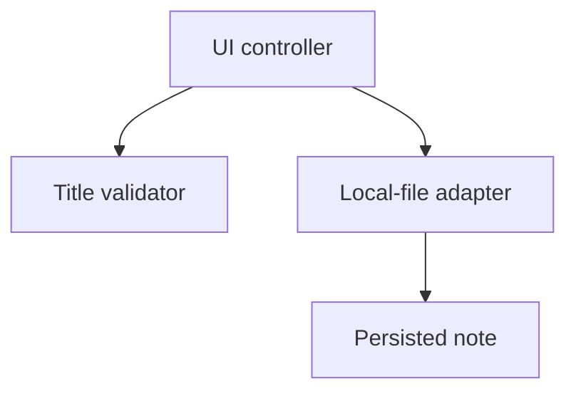

# Architecture Spine — Offline note save consistency

## Design Paradigm

Layered coordination: the UI controller orchestrates the title validator and local-file adapter. Component names describe supplied responsibilities; no source tree or implementation was inspected.

## Invariants & Rules

### AD-1 — One persistence owner [ADOPTED]

- **Binds:** UI controller, title validator, local-file adapter.
- **Prevents:** Competing writes and persistence bypassing validation.
- **Rule:** The controller validates the save candidate before invoking persistence. The validator performs no persistence. The local-file adapter alone owns durable writes; it never depends on UI state. The UI never writes the note directly.

### AD-2 — One snapshot across the save boundary [ASSUMPTION]

- **Binds:** All three components and their shared boundary contract.
- **Prevents:** A valid title being checked for one candidate while a different candidate is saved; incompatible component payloads.
- **Rule:** Define the boundary contract once and use it in all three components before independent implementation. `SaveSnapshot` is an immutable capture of the existing target note identity and editable note fields; validation reads its title projection. `Validate(snapshot)` returns `Valid(snapshot)` or `Invalid(reason)`. Only the same `Valid(snapshot)` can enter `Persist`, which returns `Committed` or `Failed(reason)` tied to that snapshot. These are semantic labels, not a new public API or storage format. Bind their concrete representation to the existing code under Open Questions; no component may choose an independent representation.

### AD-3 — Persistence confirmation and failure preservation [ADOPTED]

- **Binds:** Adapter result semantics and UI save feedback.
- **Prevents:** Premature success, failed saves destroying readable old content, and writes after invalid input.
- **Rule:** `Invalid` causes no persistence call. `Committed` is issued only when the submitted snapshot is durably persisted under the confirmed existing platform contract and becomes readable. `Failed` leaves the prior persisted note readable. The UI reports save success only for `Committed`; it reports failure for `Invalid` or `Failed`. The adapter owns the mechanism and maps storage failures to the agreed failure result. Crash and power-loss guarantees remain unverified under Open Questions.

### AD-4 — Draft and attempt ownership [ASSUMPTION]

- **Binds:** UI controller save sequencing and edit retention.
- **Prevents:** Out-of-order results, retry losing edits, and a stale save acknowledgement clearing later edits.
- **Rule:** The controller owns the current draft and allows only one in-flight save attempt. Additional save requests while pending start no persistence. Capture the snapshot once per attempt; later edits belong to a separate current draft. On `Committed`, acknowledge only the submitted snapshot and preserve later edits as unsaved. On `Invalid` or `Failed`, retain the current draft and allow retry after the attempt ends. Never reload old persisted content over retained edits as failure handling.

## Operational Envelope

Single-user, offline, local-file prototype. Keep the existing runtime and environment; no technology, framework, database, authentication, network, provider, deployment or release choice is introduced. There is no claim of existing implementation compliance or tested durability.

## Open Questions

This spine is a partial build substrate. Resolve these items against the actual implementation before parallel implementation or implementation approval:

1. Bind the shared contract in AD-2 to existing note identity, title access, all retained editable fields and error representation. The code was not supplied; these concrete types cannot be safely invented.
2. Confirm the adapter's existing durability and failure boundary for AD-3, including the meaning of persistence confirmation and preservation of the old note on failure. Crash and power-loss guarantees require explicit evidence before any promise.
3. Confirm the proposed one-in-flight policy and edit-retention behavior in AD-4 against existing UI behavior. Single-user operation alone does not establish asynchronous behavior.

## Deferred

- File format, encoding, physical layout and replacement mechanics remain adapter-owned existing implementation details, subject to AD-2/AD-3 confirmation. Revisit on any contract or durability change; do not independently change formats across components.
- Source paths and language/framework details await the existing code. No stack selection or new structural seed is authorized.
- Styling, exact error wording and internal validation algorithm remain component-local, provided agreed outcomes and current validation policy are preserved. Revisit if validation or error semantics change.
- Packaging, deployment, infrastructure, operations beyond local save behavior, account and sync features are outside this feature's scope; revisit only with separate authorization.
