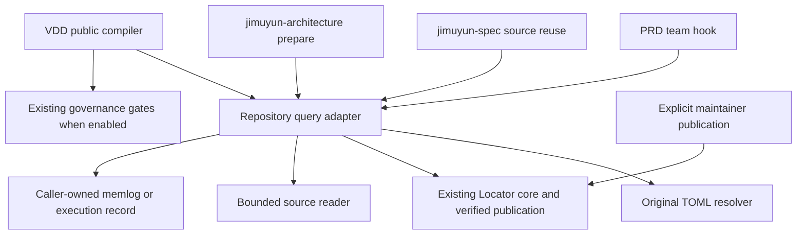

# Architecture Spine — BMAD/VDD 知识查询

## Design Paradigm

Ports and adapters：仓库拥有的阶段接入依赖共享只读查询适配层；适配层依赖现有 Locator core、配置解析和来源读取器。原生 BMAD 只消费外部传入的上下文，保持原始字节。正式治理、知识发布与 Acceptance 各自保留 owner。

## Invariants & Rules

### AD-1 — 单一查询核心与外置接入 [ADOPTED]

- **Binds:** CAP-1 至 CAP-10，BMAD/VDD adapters。
- **Prevents:** 原生修改、双份检索实现与查询记录成为新权威。
- **Rule:** Locator 仍是唯一定位核心；新代码只补共享适配和阶段消费，不新建索引服务/RAG/数据库。原生 BMAD 6.12.4、jimuyun-spec typed publication 和 jimuyun-architecture reviewer lifecycle 不被替代。下图的依赖方向不可反转；Publisher 不成为查询失败恢复路径。



### AD-2 — 消费者身份与生产来源

- **Binds:** CAP-2，catalog producer，policy/projection producer。
- **Prevents:** 借用 VDD 身份、只改 policy 却无候选、跨 domain/lifecycle 权限扩张。
- **Rule:** PRD/SPEC/Architecture 使用一个新身份 `bmad-planning`，记录中另存 stage；VDD 仍用 `vdd`。BMAD policy 限 domains=toolchain/phase，visibility=active/dependency/conditional，lifecycle=repository-source，status=active/conditional/historical，历史仅 exact-only；不包含 workspace/marketplace。路径允许 `.agents/skills/`、`docs/`、`knowledge/`、`execution-plans/`、`scripts/python/`，以及 AGENTS.md、README.md 两个 exact paths；其余授权源码只能标记为 direct-source 读取，不能假装 Locator 覆盖。消费者 policy、catalog module consumer_ids 生产规则、projection 及正式 generation 由现有生产/发布 owner 一起维护，不手改生成投影。四维隔离/Enforcement Level 继续按现有 owner 验证，规划配置不赋予 Hosted 权限。新身份缺失、未获策略准入或缺少应有发布绑定是 blocked，不是普通未配置降级。

### AD-3 — 有界预算与 P2 owner 收敛

- **Binds:** CAP-1、CAP-9，SPEC owner、Architecture owner、shared adapter。
- **Prevents:** 不同阶段各选无限预算，或 Architecture 与 SPEC 同时成为规范写入者。
- **Rule:** Architecture 提出下表的技术设计，**SPEC owner 通过 jimuyun-spec 原生派生/refresh 固化为规范合同**；进入 VDD 前本次 P2 owner 表述和数值必须在 SPEC 收敛。Architecture 不直接编辑 SPEC/selection。后续预算合同变化也走 SPEC owner，不能运行时自动扩容。

| 参数 | 默认 | 仓库硬上限 | 计量边界 |
| --- | --- | --- | --- |
| max_candidates | 12 | 20 | 一个决策 episode 的 Locator 返回候选行总数，重复行也计数 |
| max_output_bytes | 65536 | 131072 | 同 episode 累计交付给消费者的 UTF-8 查询 JSON、诊断与源码摘录字节总数 |
| max_calls | 3 | 5 | 同 episode 的 Locator 尝试总数，失败、超时和补查均计数 |
| timeout_seconds | 30 | 60 | 每次子进程尝试的墙钟上限，取消立即终止 |

有效预算是仓库硬上限、仓库团队设置、已发布 consumer policy 中已有上限和调用方更小请求的交集；personal/model 只能下调。值须为正整数，且 max_output_bytes 不低于 4096；bool/零/负数/错误类型/越界配置均 invalid_config，不静默夹取错误配置。合法 policy 比设置更小则按交集生效并记录来源。单次候选额度不超过 episode 剩余额度。原生普通数组追加不改变预算或增加次数。

子进程 stdout/stderr 各最多缓冲 65536 字节、合计最多 131072 字节；超限终止且不解析截断 JSON。每个 episode 在 max_output_bytes 内预留 4096 字节用于一次终止 JSON（预留也计入上限，不是额外额度）；普通交付不得使用该预留，预算不足立即输出终止报告后关闭 episode。终止报告保持 AD-7 必需字段，candidates/read_set 为空，index_identity 可 null；标识使用固定长度 hash/枚举，diagnostic 仅有限枚举、计数和不超过 512 字节的受控摘要，保证完整报告不超过 4096 字节，不复制原始路径或无限异常。原始诊断引用保留在既有本地记录。交付前按剩余额度检查，不发送部分 JSON。来源 hash 可流式计算完整文件，传入模型的摘录消耗输出预算；预算不足不能把未读/未验证材料当事实。耗尽记录 `budget_exhausted`、保留未完成并停止依赖尚缺事实的判断，不后台重试、不另起 episode 绕过配额。

[ASSUMPTION A1] 候选默认 12 沿用当前 CLI 默认；其余数值是保守工程起点，不是测得的性能 SLA。它们通过本次 SPEC refresh 与阶段 3 外审确定；后续真实样例若不适用，显式回到 owner 修订，不能静默放宽。

### AD-4 — 配置解析、权限交集与幂等

- **Binds:** CAP-1、CAP-3、CAP-4、CAP-9。
- **Prevents:** native 默认文件被升级覆盖、personal 扩权、重复 hook 重复运行。
- **Rule:** 查询配置采用仓库拥有的 `knowledge/planning-query.toml`，表 `[query]` 声明 enabled、stages、预算四项；入口和 stage→consumer 映射由受跟踪适配器固定，不接受自由命令、绝对路径或任意 consumer。团队文件有效值/来源可读；personal 只通过显式 narrow overrides 下调预算，不得删除仓库策略要求的阶段或修改 enabled=false 绕过本应默认执行的判断。stages 必须包含 PRD、Architecture、VDD 默认触发及 SPEC 必要补查；显式仓库 query.enabled=false 是可见的查询开关选择，须记录 disabled，不是 personal 豁免。BMAD 团队定制仍使用官方 `_bmad/custom/<skill>.toml` 及原生解析器；不修改原生 customize.toml。官方数组追加后的相同接入最终由 episode key 去重，不能依赖数组天然去重。确实未安装接入或查询配置缺失可诊断 unavailable；已有配置非法/损坏/不可读立即 blocked。

### AD-5 — 阶段触发与真实消费

- **Binds:** CAP-3、CAP-4、CAP-5、CAP-10。
- **Prevents:** 配置存在却未执行，或仅生成记录但结论未采用。
- **Rule:** PRD 团队 activation hook 将 shared adapter 的 prepare-consumption 指令放在已知任务输入之后、仓库事实结论之前；交互/headless 使用同一指令和接口。Architecture 在 wrapper prepare 中传入查询/读取结果，决定前对照上游结论。SPEC 复用已验证来源，仅新问题、缺失依据或相关变化调用补查。VDD 在 public compiler 形成边界/消费者/测试/依赖切片之前调用同一适配器，不以 governance=off 跳过。hook 无完整任务身份时不得提前声明已查，待输入确定后执行，不能据此跳过默认触发。纯措辞/排版且无事实变化可复用，须写理由。
查询后由实际 native/规划消费者读取来源并记录采纳/拒绝及范围影响；适配器不能预造“已采纳”。VDD 继续追踪当前源码、调用方、测试和控制契约。既有行为做回归，不制造假 RED。Locator 未覆盖的直接核查必须标 direct-source。

### AD-6 — 兼容诊断与失败优先级

- **Binds:** CAP-2、CAP-7、CAP-8。
- **Prevents:** exit 0 blocked 被当成功、重复校验逻辑漂移或损坏候选被降级采纳。
- **Rule:** 从现有 CLI 的真实 preflight 分支抽取可复用只读诊断，使新适配器与旧 CLI 共用同一校验核心；旧 CLI 的字段、状态及退出码保持原义。仅新消费者接口返回 `planning-query.v1` 诊断，不向未迁移调用方强塞新状态。不能用 `--allow-unpublished-inputs`、`--allow-stale-catalog` 或自选非 canonical catalog 绕过正式路径。
一次调用固定一个正式 generation，验证 manifest/catalog/policy/projection 同代 hash；不能混用读取中途切换的 current。请求 snapshot 使用 catalog 的真实 ref/commit，绝不替换为 HEAD。发布绑定损坏、非法配置/请求、策略拒绝、越界、未知状态/未知退出失败优先 blocked，不能因同时 stale/no-hit 而降级。取消终止本次查询，不抹掉已观察错误。明确不可用/超时、未命中、低置信/歧义，以及完整性/权限校验通过后识别的过期或相关来源变化，允许独立源码核查；后几类不采纳不确定候选。未知错误仍 blocked，不能伪装上述已识别状态。必要事实仍未知则停。已识别 stale 只在完整性、策略和允许范围都已成立时 degraded，不采纳失效候选。on 模式仅走既有 source_refresh，保持 ADR-0059 Knowledge-system self-change 限制。

### AD-7 — 结果与来源身份合同

- **Binds:** CAP-6、CAP-7，所有阶段。
- **Prevents:** 相同结果字段含义不同、索引身份被改为工作树身份、溯源替代规范义务。
- **Rule:** shared adapter 输出单个 UTF-8 JSON object：schema=`planning-query.v1`，episode_id、stage、operation、consumer、outcome、reason_code、index_identity、candidates、read_set、budget_usage、diagnostic。outcome 闭集为 hit/no_match/degraded/unavailable/blocked/cancelled/budget_exhausted；reason_code 由本适配合同定义，不宣称 SPEC 已定义枚举：hit=matched；no_match=empty；degraded=stale_verified/insufficient_match/ambiguous/low_confidence/source_changed；unavailable=not_installed/config_missing/backend_unavailable/timeout/disabled；blocked=invalid_config/invalid_request/policy_denied/path_denied/integrity_failed/publication_missing/unknown_failure；cancelled=cancelled；budget_exhausted=budget_exhausted。先按 AD-6 处理非法请求、结构/完整性/权限/发布失败，以及已识别过期、取消和预算状态；仅在这些前置检查通过且无更高优先级状态时，现有 Locator status=insufficient_match 且 candidates=[] 唯一映射 no_match/empty；status=insufficient_match 且候选非空才映射 degraded/insufficient_match。不得只凭空数组推断 no_match，未知或不一致状态仍 blocked。confidence 缺失/低于策略要求映射 degraded/low_confidence，已识别歧义映射 degraded/ambiguous；经验证的过期/相关源码变化分别映射 stale_verified/source_changed。degraded 结果候选仅诊断，不可采纳，后续 direct-source read_set 单独记录已核验来源；合法零命中仍要求定向源码核查，且不能绕过 required gate；原始 Locator status 与旧消费者语义不变。每项 outcome 只能对应这里列出的码；未知码/不匹配组合归 blocked/unknown_failure。diagnostic 保留经脱敏的 raw_status、exit_code、evidence_refs，不能仅靠归类丢掉真实失败证据。blocked/cancelled/budget_exhausted 不携带可采纳候选；诊断不泄露越界内容。index_identity 是实际 generation/snapshot/policy identity，无法确认时为 null，不造假；candidates 保留 Locator 原始定位/hash。read_set 每项明确 origin=locator/direct-source、path、read_identity、sha256、excerpt_range；完整性检查在任何摘录输出前完成。
read_identity 明确 snapshot/main/branch-commit/worktree；未提交字节记录工作树 hash 和基底 commit，不能称已发布 main。caller 在既有记录追加 decisions（path/hash、accepted/rejected、结论、用途/理由），不把 sources/provenance 自动升格为规范要求。既有 hash 门禁照常，轻量查询不新建全仓冻结。

### AD-8 — 记录、恢复与局部刷新

- **Binds:** CAP-6、CAP-9。
- **Prevents:** 每轮重新查询、无关 generation 导致整体重建、重启绕过预算。
- **Rule:** 结果摘要与消费决定进入阶段现有 memlog 或 VDD execution record，不强制新独立文件。episode_id 由共享 canonical hash 对 stage、operation、任务稳定标识、规范化 query scope、相关输入身份计算；同一判断重试/重复 hook/恢复共享计数，显式任务意图或相关输入改变才开新 episode并记录前驱原因。无关索引代次不进入 episode key。
复用需复核当前权限配置及实际依赖来源，保留旧 index_identity；若未重新查询，不宣称新 generation 已验证。相关来源改变只更新受影响结论和下游依赖；无关变化不自动重建历史目录或重跑全部流程。正式计划有效性仍由原有范围/绑定 owner 决定。恢复不得把失败/取消写成完成。

### AD-9 — 查询与治理分流 [ADOPTED]

- **Binds:** CAP-8，VDD、typed SPEC、Acceptance。
- **Prevents:** lightweight 查询偷偷生成治理材料或代替 required gate。
- **Rule:** 显式 governance-mode > JIMUYUN_GOVERNANCE_MODE > phase state；未设置 phase=development，auto 在 development 关闭、test/production 开启。查询开关独立，不创建 frozen knowledge、Skill-input attestation、授权、review lineage 或治理包。on 模式保留现有 required modules/冻结/来源完整性/授权检查，轻量 outcome 不满足它们。旧 ADR-0048 对强制消费的表述需要实施前记录范围增量：普通规划只读建议与正式门禁分开；不得削弱 ADR-0044/0050/0057/0059 的权限、发布、self-change 规则。

### AD-10 — 发布、迁移与稳定主持工具链 [ADOPTED]

- **Binds:** CAP-2、CAP-10，knowledge owner、维护者。
- **Prevents:** 初次新身份无有效代次、自动发布或候选中途替换主持工具链。
- **Rule:** 先在隔离候选样例验证策略生产与消费，功能合入 pinned main 后，由维护者另行显式授权既有 maintain-knowledge-base 发布包含新身份的有效 generation，才能正常使用正式 BMAD 查询。发布前不得假装新身份已准入；安装缺失与发布损坏按 AD-6 区分。生产日常查询不 fetch/checkout/改 main，不改历史证据或代次，不启动知识维护。当前需求由固定稳定工具链主持，未来 VDD 自身改动按 self-hosted 合同，候选只用于隔离验证。

### AD-11 — 运行边界与验证

- **Binds:** CAP-10，所有集成单元。
- **Prevents:** 静态配置/fixture 取代真实消费，Linux 取代 Windows，计划扩大到生产服务。
- **Rule:** 本能力只在现有仓库本地进程和文件边界运行，无新常驻服务、云 provider、数据库、Phase API、凭据或生产部署变化；依赖由现有安装流程显式供应，查询不在线安装。Python 子进程使用 argv、UTF-8、显式 root、有限 timeout/输出，Windows/Linux 同一诊断语义，取消必须终止对应子进程并保留未完成。
验证覆盖 AC-01至AC-14，含 config→trigger→真实查询/诊断→来源读取→下游范围采纳的 BMAD 与 VDD 隔离样例、重复 hook/预算恢复/损坏结果/兼容旧 CLI/on-off 分流、真实源码未命中及 Windows 路径编码子进程。fixtures 只证明确定性分支；正式完成仍归 Acceptance。本阶段未执行这些未来能力。

## Consistency Conventions

| Concern | Convention |
| --- | --- |
| 来源路径 | repository-relative POSIX；解析后 containment 与符号链接目标均核查；不存在/越界不读取 |
| 时间与字节 | UTC ISO 时间；UTF-8；预算按编码 bytes，不按字符数 |
| 记录角色 | query result 是建议；native caller 的 read/use 决定单独记录；SPEC normative/provenance 和 selection 不变 |
| 有效配置 | 记录获选值和来源链；未知字段不忽略，非法值停止；不能靠个人配置扩大硬上限或 scope |
| 安全错误 | 不输出被拒绝文件内容、凭据或完整异常环境；保留受控 reason_code 与未完成状态 |
| 依赖方向 | stage adapter → shared query → existing core；query 不调用 publisher/governance授权/其他工作流 |

## Stack

| Name | Version |
| --- | --- |
| BMAD-METHOD | 6.12.4 |
| Python reference runtime | 3.12.14 |
| uv reference runtime | 0.12.23 |

支持下限继续为现有 Python 3.11+；以上 runtime 是本次核实参考环境，不要求其他平台升级到该 patch。官方 BMAD 固定版本不是最新版声明。参考核查来源：[BMAD release](https://github.com/bmad-code-org/BMAD-METHOD/releases/tag/v6.12.4)、[Python tomllib](https://docs.python.org/3.11/library/tomllib.html)、[uv script execution](https://docs.astral.sh/uv/guides/scripts/)；本地版本/锁定 hash 另有原始证据。

## Structural Seed

```text
scripts/toolchain/knowledge_query/  # proposed shared read-only adapter, one diagnostic/state contract
knowledge/planning-query.toml      # proposed tracked team configuration
_bmad/custom/bmad-prd.toml         # external native hook, original skill untouched
.agents/skills/jimuyun-spec/       # existing typed owner, necessary supplement only
.agents/skills/jimuyun-architecture/ # existing native invocation boundary
scripts/vdd/compile_plan.py       # existing public compiler, future bounded pre-planning call
```

## Capability → Architecture Map

| Capability | Lives in | Governed by |
| --- | --- | --- |
| CAP-1 | config + shared adapter | AD-3, AD-4 |
| CAP-2 | producer/policy + Locator adapter | AD-1, AD-2, AD-6, AD-10 |
| CAP-3 | PRD team hook + consumer | AD-4, AD-5, AD-8 |
| CAP-4 | SPEC/Architecture wrappers | AD-5, AD-7, AD-8 |
| CAP-5 | VDD public compiler + direct reader | AD-5, AD-7, AD-9 |
| CAP-6 | read_set + caller record | AD-7, AD-8 |
| CAP-7 | shared diagnosis | AD-3, AD-6, AD-7 |
| CAP-8 | governance owner | AD-9 |
| CAP-9 | episode/reuse counters | AD-3, AD-8 |
| CAP-10 | real integration evidence | AD-10, AD-11 |

## Deferred

- 内部函数拆分、单元测试文件名：由实施根据现有代码组织选择；不得产生另一套校验/诊断语义。
- S2 执行排期 Q1：维护者在 S2 工作前决定；技术非依赖不授予并行权。
- 初次知识发布的执行时刻：维护者在实现验证并合入 main 后另行授权；本次不发布。
- Phase 服务、Hosted 隔离、账号/生产节点、游戏业务、Package B、全仓索引/RAG：明确不属本增量，不成为隐含部署任务。
- ADR-0048 适用范围增量：在相关实施前由既有 ADR owner 记录采纳；本 spine 是该增量设计输入，不伪造 Accepted 状态。
